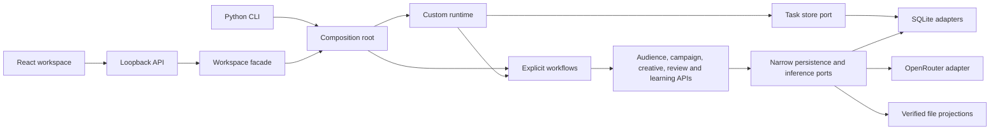

# Architecture

Direct Acquisition Agent is one deployable Python modular monolith with a React presentation client. Business modules own their rules and expose narrow public contracts. Application services depend on ports; SQLite, filesystem, synthetic data and OpenRouter adapters implement those ports. `bootstrap.py` is the composition root.

The custom runtime persists tasks and schedules explicit workflow steps. The model reasons within a bounded copy workflow; code owns population policy, budget calculations, task state, artifact identity, approval and counted outcomes. This keeps model behavior replaceable without moving authority into prompts or browser state.

## System structure



The browser and CLI are entry points to the same application rules. A single local server serializes worker execution and holds a per-root POSIX file lock. Revisioned message appends and read-only progress use their own SQLite transactions so they can proceed during inference. The supported worker topology is one active worker. Selected concurrent database tests establish specific transaction invariants, not general multi-node readiness.

## Module ownership

| Module | Responsibility | Authority it does not own |
| --- | --- | --- |
| `runtime` | Run/task lifecycle, leases, attempts, waiting and result commits | Campaign policy, copy quality, approval or outcomes |
| `audiences` | Business records, immutable snapshots and source contracts | Model-generated eligibility or inferred source completeness |
| `campaigns` | Selection, exclusions, A/B/no-mail assignment, integer money and exact drafts | Reviewer decisions or external dispatch |
| `creative` | Creative identities, frozen editorial context, bounded generation and grounding validation | Approval, targeting policy or outcome counts |
| `reasoning` | Provider-independent limits, gateway contracts and inference journal | Business approval or automatic uncertain-call retries |
| `reviews` | Proposals, subjects, decisions, invalidation and simulated acceptance | Hosted authentication or real agency effects |
| `learning` | Cohort membership, immutable observations, counted posteriors and recommendations | Automatic campaign mutation or new product facts |
| `conversations` | Persistent user messages, revision-bound brief interpretation, scoped planning admission, bounded preparation continuation through host ports and read models | Campaign policy, approval, dispatch or verified source facts |

`workflows` composes public module APIs. Cross-module imports use the provider's `__init__.py`; domain code uses pure standard-library values, declared domain contracts and technical serialization helpers. Runtime has no dependency on business modules. Adapters keep SQL private. The architecture checker rejects prohibited dependencies, private imports and cycles.

## Repository map

```text
frontend/src/                 React views, API client and presentation styles
src/acquisition/
  runtime/                    task lifecycle and bounded worker
  audiences/                  records and snapshot contracts
  campaigns/                  campaign rules and draft service
  creative/                   copy loop, evidence and editorial context
  reasoning/                  inference contracts and reservation journal
  reviews/                    proposal and approval services
  learning/                   cohorts, outcomes and recommendations
  conversations/              persistent intent, bounded briefs and preparation coordination
  workflows/                  integration through public contracts
  adapters/                   SQLite, OpenRouter, files and report projections
  bootstrap.py                composition root
  workspace.py                local workspace facade
  workspace_server.py         loopback transport and static asset serving
  conversation_cli.py         explicit conversation and planner commands
  __main__.py                 CLI entry point
config/                       editorial guidance, fact pack and evaluation cases
tests/                        pure rules, SQLite, HTTP and process recovery
frontend/tests/               real-backend client and Chromium regressions
scripts/                      architecture, mutation and optional model evaluation
docs/                         product guides and technical references
```

Within each business module, `domain.py` holds pure values and invariants, `application.py` coordinates use cases and `ports.py` defines required I/O. Extra abstractions are introduced only for an implemented consumer. There is no generic repository layer, message bus or workflow language.

## Durable objects and transaction boundaries

| Object | Binding and commit rule |
| --- | --- |
| Preparation coordinator | Exact revision, request, frozen planning context and immutable copy permission commit before planning admission; restart reconciles the original run and stops at unapproved review |
| Run and task plan | Organization/request identity binds exact inputs and capability versions; changed inputs conflict |
| Worker lease | Current token and expiry are checked again in the result/failure transaction |
| Audience snapshot | Content-addressed bytes and organization are verified on read |
| Draft and creative | Exact content, assignments, money and file hashes bind identity; export files are rebuildable projections |
| Inference call | Reserve before dispatch under the active lease; replay completed matching receipts; fence unknown outcomes |
| Creative context | Freeze product evidence, editorial preferences and all required segment learning from one read snapshot |
| Review subject | Bind immutable proposal, evidence/suppression epochs, policy, purpose and revision |
| Approval | Bind subject, reviewer generation, reason and bounded lifetime; recheck at acceptance |
| Simulator acceptance | Approval validation, one accepted job, audit and command receipt commit together |
| Learning finalization | Complete mature observations, counts, digests, beliefs, event and receipt commit together |

Domain artifacts and runtime receipts are separate commits under stable operation identities. A crash after draft persistence but before task acknowledgement recovers the same artifact. This works for these idempotent local operations; it is not a guarantee for future non-idempotent remote effects. Cancellation fences later task commits but may leave an unreferenced immutable artifact from computation already in flight.

The workspace has a separate `workspace.sqlite` control store for session metadata, command fingerprints and scoped preparation records. Each sandbox owns its application database; descendant experiments share their parent's organization/database to reuse learning. Paths and organizations resolve from server-owned metadata. The control and domain stores do not share a distributed transaction. Durable command admission precedes execution; after a lost metadata write, the same request reconciles through original domain receipts. Browser session storage preserves pending identity per command signature after uncertain responses.

## Audience and experiment semantics

A snapshot contains supplied segment, model/version, propensity, suppression, address and contact metadata. The agent does not train the segmentation model. Duplicate business identities are all excluded. Ordered exclusion reasons make terminal counts reconcile. The synthetic source's completeness flag describes its own batch; a real feed needs independent completeness and freshness checks.

Selection enrolls a bounded high-score cohort before deterministic randomization within each segment. Integer-pence calculations reserve conservatively, including potential controls, so some budget may remain unused. Small segments may lack a control group; the manifest exposes that limitation. Assignments retain business, segment, arm and creative identity for outcome joins.

## Inference, memory and evidence

The workflow pins model, limits, guidance, catalogue and evidence identities. Worker eligibility is checked before claim, so incompatible model settings do not consume attempts or terminally fail resumable work. The journal reserves calls before dispatch and persists response/usage metadata. Unknown provider outcomes stop automatic retries.

Only aggregate synthetic audience context is supplied to the model. Editorial preferences are writing judgments. Finalized synthetic outcome memory carries explicit counts and creative/cohort provenance. Neither becomes source evidence or approval. New copy has a new identity and cannot inherit old approval or response counts. Grounded rendering and the separate semantic screen are described in [product grounding](product-grounding.md).

## Review and learning authority

Review decisions are distinct from the runtime's dry-run checkpoint acknowledgement. Read-only HTML and cached receipts cannot authorize acceptance. Current evidence, suppression epochs, reviewer generation, expiry and exact artifact integrity are checked transactionally. Restoring earlier evidence bytes cannot revive authority because epochs are monotonic. Accepted history is immutable. See [review reference](reviews.md).

Learning starts from verified accepted assignments, including controls. Missing rows stay unknown; full explicit coverage and a closed window are required before counting. Finalized cohorts and observations are immutable, and repeated business exposure within an organization is rejected. Finalization replay observes the original receipt without another effect event. All segment memories for a new copy run come from one read transaction. Recommendations are advisory and cannot mutate a campaign. See [learning reference](learning.md).

## Local transport and identity

The server binds to `127.0.0.1`, checks Host and per-start browser token, and requires the exact local Origin for mutations. Absolute-form request targets are rejected before routing. JSON bodies are bounded, CORS is not permissive, static files are confined to compiled assets and downloads bind exact displayed subjects. Provider secrets remain server-side.

These are local transport controls. Organization flags and configured actors are trusted local administration, not hosted authentication or separation of duties. A public service needs the additional identity and operational controls in [scalability](scalability.md).

## Schema and compatibility

The application database is schema v6. Initialization takes a write lock before reading `user_version` and holds it through the entire migration chain. DDL and version changes roll back together. Statements execute individually because `executescript` can commit an outer transaction. WAL activation runs after migration and retries only busy errors on fresh connections with a bounded deadline.

Schema v3 froze exact legacy task-plan admissions; later migrations preserve that cutoff. Historical v2 workflows resume only with their original admission certificate. New v2 admission and capability/input downgrades are rejected. Repair of the known older stale-marker state preserves the original cutoff rather than certifying later records. Schema v4 added review state; v5 added learning state; v6 adds conversations, messages and planning admissions. Older binaries reject newer schemas, and mixed-version rollback is unsupported. Durable timestamps and derived lease/retry deadlines must be finite.

## Conversational planning

`ConversationService` uses its persistence port and the public runtime task port. The composition root wires its SQLite adapter and `ConversationPlanner`; runtime remains business-agnostic. Each planning admission freezes the complete bounded message history, earlier planning results, capability guidance and model settings before creating one runtime task. If the process stops between those commits, retrying the original request creates or retrieves the same task plan. Results commit only through the runtime's lease-checked task/event transaction. They are immutable proposals, never review decisions.

The planner exposes one tool, `submit_campaign_brief`, and returns a complete brief proposal, clarification or unsupported explanation. Code validates shape, supported segments, budget provenance and output bounds. A local structured playbook set is supplied at planning admission and frozen with the existing knowledge snapshot; the UI can inspect both that snapshot and the separate baseline product and editorial sources. React and the guarded loopback API can prepare a synthetic campaign from a current validated proposal, using fixture copy or explicitly requested grounded generation. The versioned conversational model workflow reuses the existing copy agent and inference journal, with scoped contexts and selected-segment tasks. The source brief and conversation revision are rechecked in the review transaction, so a later message blocks approval and acceptance of the older draft. General document retrieval, real audiences and delivery remain future work. See [conversation planning](conversations.md).

The server advances saved active preparations through the existing targeted worker and campaign services outside the HTTP request. The conversation module owns continuation state through narrow host/store ports, with concrete wiring in `bootstrap.py`. It stops on source edits, missing consent, clarification or terminal failure, and never invokes review decisions or handoff. Unknown provider outcomes remain fenced after restart. See [continuous preparation](conversations.md#continuous-preparation).

## Testability and evolution

Pure policy tests, real SQLite fault/concurrency tests, separate-process CLI recovery and real HTTP/browser journeys complement each other. None alone proves the entire system. See [validation](validation.md) for current evidence and gaps.

The modular monolith remains the default until measured concurrency or operational requirements justify a change. Ports isolate dependencies, but a PostgreSQL migration, multi-worker operation or external dispatch still requires implementation and new failure/recovery evidence. The [scaling path](scalability.md) specifies those changes without presenting them as shipped capabilities.
