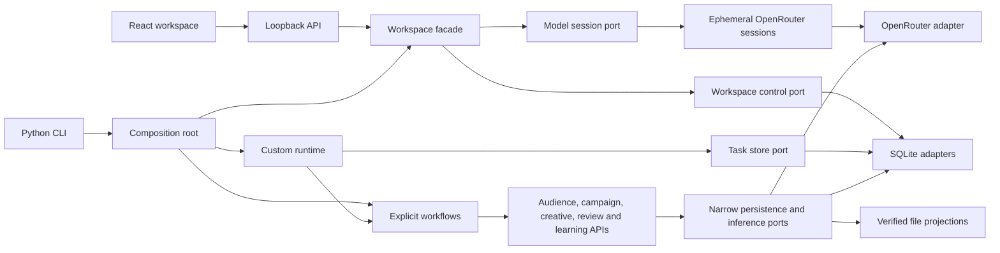

# Architecture

GTM Agent Platform is one deployable Python modular monolith with a React presentation client. Business modules own their rules and expose narrow public contracts. Application services depend on ports; storage, filesystem, synthetic data and OpenRouter adapters implement those ports. `bootstrap.py` is the composition root. The [product overview](product.md) separates installed capabilities from the intended hosted product.

The [go-to-market platform map](gtm-platform-map.md) defines the agreed future
product-area taxonomy, native channel ownership, shared-service boundaries and
channel access requirements. It does not move packages or install commerce
capabilities. `acquisition` remains the current Python namespace; the module
responsibilities below describe installed code.

The custom runtime persists tasks and schedules explicit workflow steps. Models reason within bounded planning, copy and explicitly composed evaluation paths; some channel paths use authored fixtures. Code owns population policy, budget calculations, task state, artifact identity, approval and counted outcomes. This keeps model behavior replaceable without moving authority into prompts or browser state.

## System structure



The browser and CLI are entry points to the same application rules. A single local server serializes worker execution and holds a per-root POSIX file lock. Revisioned message appends and read-only progress use their own SQLite transactions so they can proceed during inference. The supported worker topology is one active worker. Selected concurrent database tests establish specific transaction invariants, not general multi-node readiness.

The [local checkpoint adapter](workspace-checkpoints.md) uses the same root lock and SQLite writer locks to capture the application stores and legacy journal while writers are stopped. The restored root opens for historical inspection with application mutations fenced.

## Module ownership

The first [offline contextual benchmark](youtube-contextual-benchmark.md) adds
a YouTube-owned read-only recommendation service and pure allocation/evidence
rules. Bootstrap injects bundled candidate data and optional authored ranking
receipts through narrow ports. It changes no schema, runtime, live model serving
or provider authority. Its synthetic response support remains separate from
instruction experiments and real participant evidence.

The opt-in contextual model evaluator is composed separately by
`build_youtube_ranking_evaluation`. It uses the existing runtime and inference
journal in a dedicated local evaluation store, with exact saved requests and
independent grading before task commit. Workspace workers do not install this
evaluation capability. Recorded ranking proposals enter the existing YouTube
recommendation port; core allocation policy and provider/spending authority
remain unchanged. Only named Decimal value imports are added to the static
architecture whitelist; temporary dependency exceptions remain empty.

Evaluation plan/report v3 checks source identity inside each leased case and
records a final source-validation task after the paid cases. The runtime saves
source-instability failure codes and the successful validation receipt. Report
completion and aggregate grades require that saved verdict. Inspection never
derives past execution validity from a restored checkout. No runtime schema or
production capability registration changes are needed for this evaluation gate.
The evaluation's first-attempt recovery policy fences reclaimed cases and
final validation before effects. A lease-lost attempt may have observed a
mismatch without retaining authority to persist its failure. Durable attempt
counts and saved recovery flags therefore make that interval unverified even
after source restoration. Provider replies/billing remain inspectable; generic
inference receipt recovery outside this evaluator is unchanged.

The proposed [contextual targeting feasibility design](targeting-decisioning-feasibility.md)
keeps channel decision/reward policy in `youtube`, model calls behind existing
`reasoning` ports, shared creative references in `creative`, and provider
capability/context/reporting mechanics in injected adapters. #143/#144 are
implementation/evidence gates before the next #133 measurement slice. No
universal decision engine or new runtime dependency is installed by this plan.

The proposed [shared creative asset storage design](creative-asset-storage-design.md)
keeps YouTube channel rules native and places reusable asset identity/catalogue
under `creative`, with injected local/Blob file adapters. This is a future
contract, not an installed asset library or hosted delivery claim.

The [intake persistence slice](intake.md) keeps user-supplied company draft values
in `creative` and campaign requirements plus intake coordination in `campaigns`.
Its organization-scoped immutable revisions grant no grounding or execution
authority. Bootstrap selects the shared local SQLite or Turso adapter; no hosted
entry point or Gateplane dependency is introduced by this slice.

| Module | Responsibility | Authority it does not own |
| --- | --- | --- |
| `youtube` | Native authored placement packages, exact manual review, approval and export through one UI/tool command surface | Human decisions from model output, live ad buying or shared postal/sequence subjects |
| `runtime` | Run/task lifecycle, leases, attempts, waiting and result commits | Campaign policy, copy quality, approval or outcomes |
| `audiences` | Business records, immutable snapshots, versioned source discovery, scoped native account/contact identity, permission/pressure observations, objections and frozen categorization/decision strategy contracts | Model-generated eligibility or inferred source completeness |
| `campaigns` | Selection, exclusions, A/B/no-mail assignment, integer money and exact drafts | Reviewer decisions or external dispatch |
| `engagements` | Synthetic enrollments, reserved step lifecycle, submission observations, native stops and operational accounting | Product facts, audience allocation, approval or live transport authority |
| `creative` | Creative identities, confirmed writing preference lifecycle, frozen editorial context, bounded generation, grounding validation and permitted recipient facts with scoped provenance | Approval, targeting policy or outcome counts |
| `reasoning` | Provider-independent limits, gateway contracts, inference journal and pure versioned reasoning-asset serialization/integrity contracts | Business approval or automatic uncertain-call retries |
| `reviews` | Proposals, subjects, decisions, targeted copy-feedback admission, invalidation and simulated acceptance | Hosted authentication or real agency effects |
| `learning` | Cohort membership, immutable observations, counted posteriors and recommendations | Automatic campaign mutation or new product facts |
| `conversations` | Persistent user messages, revision-bound brief interpretation, scoped planning admission, bounded preparation continuation through host ports and read models | Campaign policy, approval, dispatch or verified source facts |

`workflows` composes public module APIs. Cross-module imports use the provider's `__init__.py`; domain code uses pure standard-library values, declared domain contracts and technical serialization helpers. The conversation application uses the campaign module's public, pure `CampaignScope` capability contract when recording requested requirements. Literal source resolution belongs to conversations; campaign construction and supported delivery values belong to campaigns. Runtime has no dependency on business modules. Adapters keep SQL private. The architecture checker rejects prohibited dependencies, private imports and cycles.

## Enforced dependency contract

`make arch-check` statically inspects every Python file under `src/acquisition`,
without importing product code. `scripts/architecture_policy.json` is the reviewed,
exact module-to-role inventory and temporary exception ledger. It classifies
every production module, including workspace application/views, startup and HTTP adapters, compatibility wrappers, engagements and supporting
files and every root utility. An added file needs an explicit classification;
removed files must lose their classifications. A file/package name collision is
rejected. Tests and scripts are outside this production inventory and cannot be
imported by production code. Existing CI runs this gate and discovers its tests
through the backend suite.

| Role | Permitted production dependencies |
| --- | --- |
| Domain and technical contracts | Pure domain values/rules and technical contracts; technical contracts cannot depend on business modules |
| Ports | Domain values, other narrow ports and technical contracts |
| Business application | Own domain, ports and services; declared public provider-module APIs |
| Workspace application | Public module APIs, application collaborators and workflow composition |
| Public API | Explicit exports from the owning module's domain, ports and application code |
| Workflows | Public business APIs, other workflow composition and technical contracts |
| Adapters | Public business contracts/validators, adapter helpers, infrastructure and technical contracts |
| Infrastructure helpers | Other infrastructure helpers and technical contracts |
| Bootstrap composition | Concrete adapters, services, workflows and transport; no entrypoint or compatibility-wrapper dependencies |
| Entry points | Bootstrap, public APIs, application/transport and startup helpers; delegate provider/SQLite I/O |
| HTTP transport | Application/public APIs, infrastructure helpers and technical contracts; no bootstrap or concrete provider/store wiring |
| Compatibility wrappers | Named exports from canonical entrypoints or public APIs, plus an optional `main()` launch; no behavior or composition |

Business dependency directions remain explicitly declared in the checker:
campaigns uses audiences/creative; creative uses reasoning/audiences; reviews uses
audiences/campaigns/creative/runtime; conversations uses reasoning/runtime/audiences/
campaigns; engagements uses campaigns. Runtime, audiences, reasoning and learning
have no outbound business-module dependencies. Cross-module imports use named,
non-private exports from the provider's `__init__.py`. Namespace and wildcard
imports cannot hide which public contract a consumer uses.

Purity applies to supporting domain files, not only files named `domain.py`.
For example contacts, strategies, sequences, profiles and recipient-context values
have explicit domain roles. Grounding, channel-generation and action files that
coordinate services have application roles. Domain and port imports through a
public facade are resolved to their defining modules, including relative imports
and simple re-export aliases. Exporting a service beside a value does not make
that service a domain dependency. Conditional, cyclic or computed exports that
cannot be resolved are rejected as public dependencies. Tuple, list, nested and
starred unpacking invalidate every reassigned export; an earlier pure alias
cannot survive an unresolved replacement. Simple aliases capture their binding
at assignment time; rebinding the source name cannot retarget a previously
exported value or local declaration.

Core/application imports use explicit value and coordination allowances, rather
than allowing the standard library by default. This rejects alternate native
SQLite/socket/process modules, foreign-function loaders, filesystem APIs,
undeclared submodules and provider clients regardless of their stdlib status.
Ports may use `pathlib.Path` as a value type. `asyncio` is treated as infrastructure because it exposes network and
subprocess effects, including through aliased and submodule imports. It remains
adapter-side, behind ports; HTTP transport has its own explicit protocol allowance. Pure code has a bounded
standard-library import set with exact module paths and named exports; pure URL
parsing is permitted separately from URL retrieval. Mixed modules require named values:
`io.StringIO`/`io.BytesIO` and `uuid.UUID` are allowed, while namespace imports and
file-opening or UUID-discovery APIs are not. Existing memory-buffer use imports
`StringIO` directly. Ports and entry points may import the named `Path` type;
entry points additionally admit `argparse`. The reviewed coordination allowance
is limited to contextlib, contextvars, copy, secrets, threading and time. Package
from-imports resolve only declared child modules, so `from json import tool`
cannot bypass the module allowance. New standard-library dependencies or
export names require an explicit policy review. Explicit dynamic import/code
mechanisms are rejected across production roles. The checker also rejects eager module
initialization cycles and package dependency cycles, including imports deferred
inside functions. Module-level conditional imports are conservatively treated
as initialization dependencies. Submodule imports also add edges to parent
package initializers outside the importing module's already-entered ancestor
chain. This catches initialization cycles hidden behind nested packages without
adding false back edges for ordinary sibling imports. Deferred imports within
an adapter package are allowed: they are not an eager initialization cycle. They
still receive all ordinary import checks. This is a static dependency contract, not a sandbox, a call-graph analysis
or proof that arbitrary Python code cannot perform I/O through an injected object.
Transactions, current authority and real recovery remain behavioral test concerns.

Transport is subject to the same explicit external-import checks. Its additional
allowances cover the named `http.server.BaseHTTPRequestHandler` and
`ThreadingHTTPServer` classes, named `Path` for confined static assets,
`mimetypes.guess_type`, legacy startup argument parsing, `ExitStack`, and worker
`Thread`/`Event` lifecycle helpers. HTTP server namespaces, client HTTP libraries,
SQLite/native storage, provider SDKs and other undeclared infrastructure are
rejected. A transport role is not a general adapter exemption.

### Temporary exception ledger

The initial #89 inventory recorded **31 exact dependency exceptions**. Issues
#90, #91 and #92 removed all of them. Issue #93 closes the migration: the JSON
ledger must be exactly `exceptions: []`. Even an exact former exception with a
removal issue and reason now fails the gate. All import, export, classification
and cycle diagnostics are unconditional. Legitimate startup wrappers retain
explicit roles and strict forwarding shapes, not dependency exceptions. The
checker has no baseline-refresh or migration-reopen command. Inventory and role
changes require explicit review. The [integrated evidence contract](hexagonal-boundaries.md)
records actual recovery scenarios, commands, source fingerprints and limits.

The contact adapter uses the named public `evaluate_contact_eligibility` policy.
Review's fact-pack and grounded-catalogue validators resolve to
`creative/grounding_policy.py`; copy schemas live in `creative/copy_contracts.py`.
Both are pure domain owners. Model orchestration remains in
`creative/grounding.py`. Review and learning reports are bootstrap-injected output
callbacks on the campaign application. Offline recovery commands receive a
storage-error boundary from bootstrap; only its SQLite adapter imports native
SQLite exceptions.

## Repository map

The [organization/profile foundation](organization-profiles.md) adds explicit taxonomy, campaign, product/brand and planning contracts inside the existing modules. `ProfilePreparation` composes their public APIs and a narrow atomic proposal-publication port, reusing campaign calculation without adding marketing dependencies to runtime. The CLI prepares unapproved synthetic proposals for two companies; chat, model execution, review/handoff and learning keep their existing contracts. The [channel expansion plan](channel-expansion-plan.md) describes subsequent proposed work.

The [contact evidence foundation](contact-evidence.md) adds `ContactDirectory`, `ContactSource` and `ContactDirectoryStore` within audiences. `campaigns.contact_eligibility` owns hard preparation checks; SQLite loads current review-owned business suppressions without changing their authority. Native provider types and execution identities stay separate from mapped roles, connection aliases and mapping versions. Source attestations, monotonic versions, known identity coverage, lifecycle history and current evidence are checked during atomic assessment publication. Bootstrap wires only recorded synthetic sources. Runtime and existing postal formats gain no contact dependencies, and these assessments confer no campaign, approval or sending authority.

The [audience strategy slice](audience-strategies.md) adds audiences-owned frozen feature and typed result contracts with separate categorization and decision ports. Two offline ranking adapters share the campaign-owned contact selection policy. SQLite reconstructs current input evidence and rechecks it after atomic publication into the existing audiences-owned contact command journal. No schema migration or historical artifact rewrite is needed. Paid inference, sequence execution and outbound-capacity reservation remain outside this slice.

The [recipient context slice](recipient-context.md) adds creative-owned recipient source and publication ports. Creative depends on audiences' public native-reference domain contracts for exact contact/account identity. Its installed adapter supplies reviewed synthetic observations; typed facts, permitted use, current history and evidence spans determine bounded prompt projections. Raw source bodies do not enter those projections or durable receipts. Context publication rechecks the current contact assessment inside its transaction and grants no copy, campaign, review or sending authority.

```text
frontend/src/                 React views, API client and presentation styles
src/acquisition/
  runtime/                    task lifecycle and bounded worker
  audiences/                  records, snapshot contracts and versioned source discovery
  campaigns/                  campaign rules and draft service
  creative/                   copy loop, evidence and editorial context
  reasoning/                  inference contracts and reservation journal
  reviews/                    proposal and approval services
  learning/                   cohorts, outcomes and recommendations
  conversations/              persistent intent, bounded briefs and preparation coordination
  engagements/                synthetic enrollment, step lifecycle, stops and observations
  workflows/                  integration through public contracts
  adapters/                   SQLite, OpenRouter, files and report projections
  bootstrap.py                composition root
  application/workspace/      service, ports, state access and read-only views
  adapters/http/              loopback routing, guards and static asset serving
  entrypoints/                CLI dispatch, offline commands and server lifecycle
  workspace.py                compatibility exports for the public facade
  workspace_server.py         compatibility launch for the workspace server
  *_cli.py, *_demo.py          compatibility exports for canonical entrypoints
  workspace_*.py              compatibility launches for offline recovery commands
  legacy_migration.py         compatibility launch for offline legacy recovery
  __main__.py                 compatibility launch for the CLI
config/                       editorial guidance, fact pack and evaluation cases
tests/                        pure rules, SQLite, HTTP and process recovery
frontend/tests/               real-backend client and Chromium regressions
scripts/                      architecture, mutation and optional model evaluation
docs/                         product guides and technical references
```

Within each business module, `domain.py` holds pure values and invariants, `application.py` coordinates use cases and `ports.py` defines required I/O. Extra abstractions are introduced only for an implemented consumer. There is no generic repository layer, message bus or workflow language.

## Durable objects and transaction boundaries

| Object | Binding and commit rule |
| --- | --- |
| Preparation coordinator | Exact revision, request, frozen planning context and immutable copy permission commit before planning admission; restart reconciles the original run and stops at unapproved review |
| Paused atomic planning admission | Verified source, exact generation decision and frozen intent precede one transaction for tasks, explicit ownership, planning record, audit and receipt; execution remains fenced until cutover |
| Run and task plan | Organization/request identity binds exact inputs and capability versions; changed inputs conflict |
| Worker lease | Current token and expiry are checked again in the result/failure transaction |
| Audience snapshot | Content-addressed bytes and organization are verified on read |
| Draft and creative | Exact content, assignments, money and file hashes bind identity; export files are rebuildable projections |
| Inference call | Reserve before dispatch under the active lease; replay completed matching receipts; fence unknown outcomes |
| Creative context | Freeze product evidence, editorial preferences and all required segment learning from one read snapshot |
| Review subject | Bind immutable proposal, evidence/suppression epochs, policy, purpose and revision |
| Approval | Bind subject, reviewer generation, reason and bounded lifetime; recheck at acceptance |
| Simulator acceptance | Approval validation, one accepted job, audit and command receipt commit together |
| Learning finalization | Complete mature observations, counts, digests, beliefs, event and receipt commit together |

Domain artifacts and runtime receipts are separate commits under stable operation identities. A crash after draft persistence but before task acknowledgement recovers the same artifact. This works for these idempotent local operations; it is not a guarantee for future non-idempotent remote effects. Cancellation fences later task commits but may leave an unreferenced immutable artifact from computation already in flight.

The workspace has a separate `workspace.sqlite` control store for session metadata, command fingerprints, scoped preparation records and scoped copy-revision blocker codes. Blocker metadata is a recoverable projection and grants no task, model or review authority. Each sandbox owns its application database; descendant experiments share their parent's organization/database to reuse learning. Paths and organizations resolve from server-owned metadata. The control and domain stores do not share a distributed transaction. Durable command admission precedes execution; after a lost metadata write, the same request reconciles through original domain receipts. Browser session storage preserves pending identity per command signature after uncertain responses.

Unsealed compatibility stores still keep preparation intent, routing and sandbox time in `workspace.sqlite`. In schema 14, explicitly selected `verified-paused/v1` stores move new preparation intent and consent to `conversations.sqlite`, and new sandbox environments, clocks, command identities and run/case/cohort mappings to the campaign's application database. The root application store contains a server-owned location catalogue bound to each application's immutable store identity. This catalogue locates records; it cannot grant consent, advance time or authorize execution. Owned records override workspace projections, including after the projection database is lost. Legacy workspace records are never silently enrolled as authoritative environments.

### Workspace composition and model sessions, issue 91

`bootstrap.build_workspace` constructs the facade with its control/state ports,
model-session interface, reviewed asset loaders, scoped application factory and
preparation coordinators. `application/workspace/service.py` contains no bootstrap imports, provider
construction, credential reads or filesystem configuration loading. The factory
keeps existing authoritative environment routing, lazy verified-store selection
and compatibility-store behavior. Construction does not dispatch a model or
silently seal a store before the server's root lock is acquired.

| Location | Responsibility |
| --- | --- |
| `application/workspace/ports.py` | Consumer-owned model-session and bounded scoped-construction interfaces, alongside the control-store ports |
| `adapters/models/workspace_sessions.py` | OpenRouter catalogue caching, key validation, opaque tab handles, five-minute idle expiry, the 32-connection bound, frozen model matching and provider price-tier checks |
| `workflows/preparation_host.py` | Implements the preparation host over injected conversation APIs and narrow campaign/generation continuations; preserves the existing consent, admission and stop rules in their owners |
| `workflows/campaign_application.py` | Campaign creation/replay, frozen copy context preparation and export use cases over injected stores, population generation, reviewed assets and an export effect |
| `application/cli_commands.py` | Executes CLI commands using the supplied application and explicit legacy review/learning delegates |
| `application/workspace/service.py` | Injected workspace coordination and use cases, exported by `application/workspace/__init__.py` |
| `application/workspace/views.py` | Read-only campaign/action/preparation progress and blocker wording |
| `adapters/http/workspace_server.py` | Loopback routing, serialization, static assets and unchanged request guards |
| `entrypoints/workspace.py` | Root lock, recovery, scheduler and request-draining shutdown lifetime |
| `entrypoints/cli.py`, `entrypoints/*_cli.py` | Argument parsing, dispatch and presentation of results through bootstrap-built applications |

`ScopedWorkspaceApplications` is bound to one server-owned root and constructs
only campaign or fixed conversation applications. It accepts explicit resolved
organization/store scope, clock and frozen model settings. It has no arbitrary
service names, registration mechanism or caller-provided database path. New
verified preparation construction is deferred only until that store scope is
selected. The preparation coordinator receives `WorkspacePreparationHost`, not
the workspace facade; bootstrap composes its narrow callbacks before exposing
the completed facade. The facade retains thin method delegates for existing
presentation/recovery callers, without selecting implementations.

The model-session interface preserves OpenRouter-specific catalogue and price
semantics. It does not claim that every provider supports the same catalogue,
key validation or price tiers. Credentials stay in the adapter/composition
boundary and never enter durable records or model inputs. Browser sessions remain
ephemeral, scoped to their original tab/key binding, and unusable after expiry or
restart until explicit reconnection. A restored binding can continue the frozen
request; a new model selection does not rewrite that request's settings.

Asset loaders are lazy. Historical admissions and receipts can be observed or
resumed using their frozen inputs when current skill files are unavailable.
New work still performs the existing freshness/configuration checks. Moving
`bootstrap.Application` methods into the campaign workflow changes no schema,
authority, task plan, reservation or legacy cutover rule. `bootstrap.Application`
remains a compatibility export of that workflow owner.

### Workspace control storage, issue 90

`application/workspace/ports.py` owns the control-store contract and recoverable
storage failure. `adapters/sqlite/workspace_control.py` implements its named
operations. `bootstrap.build_workspace_state` composes that adapter, storage
error translation and a lazy factory for the existing `conversations.WorkspaceState`
service. Startup initializes the compatibility journal without opening or
silently enrolling an authoritative application store. The workspace facade
passes session candidates and receives plain records; it contains no SQLite
imports, SQL or connection accessor. Its construction and provider dependencies
are now supplied by `build_workspace`, as described above.

The complete control-store inventory is:

| Records | Ownership and readers | Writers and commit boundary |
| --- | --- | --- |
| `sessions` | Compatibility intent, routing, time and domain links for unsealed legacy roots; disposable navigation payloads for owned environments. Workspace listing, lookup, ancestry/recovery and command flows read through the control port. Offline checkpoint and legacy inventory adapters also inspect these records as evidence. | Control adapter session creation, save and case-link restoration; owned-state projection upsert. Creation rechecks fingerprints under a writer transaction. Projection updates preserve historical request hashes. Offline projection repair also writes this table. |
| `commands` | Legacy command fingerprint and completion journal, read by workspace action replay. Owned commands instead use `WorkspaceStateStore` in application storage. | Control adapter admission and completion. A report-check clock update and pending command insert commit together. Domain execution occurs after this transaction closes. Offline projection repair can reconstruct owned command projections. |
| `conversation_draft_requests` | Compatibility mapping for the fixed server-owned `local-conversations` scope. Draft replay and preparation generation read it through the port. | Session plus mapping admission is one control-store transaction, inside the existing conversation creation fence. Owned request mappings stay in application storage; offline repair can rebuild their projections. |
| `followup_prepare_requests` | Organization-scoped legacy follow-up request mapping, read when admitting a continuation. | Session plus mapping admission commits together, with both original request and session fingerprints checked. Owned mappings remain in application storage; offline repair can reconstruct their projections. |
| `copy_revision_blocks` | Organization/revision-scoped recoverable presentation metadata read by revision progress. It grants no inference permission. | Control adapter set/clear operations from revision recovery; offline projection repair clears diagnostics for positively owned keys. |
| `checkpoint_recovery_blocks` | Organization/run-scoped recoverable presentation metadata read by checkpoint recovery/status. It grants no review or execution authority. | Control adapter set/clear operations after case recovery; offline projection repair clears diagnostics for positively owned keys. |
| `preparations` | Existing organization-scoped legacy preparation intent/progress, consumed by `PreparationCoordinator` through `PreparationStore`. | Existing `SqlitePreparations` adapter, unchanged by this extraction. Authoritative preparation intents remain in `SqlitePreparationIntents`. |
| `workspace_identity` | Immutable ancestry witness, read by existing ancestry, inventory and checkpoint adapters. It does not enroll a domain history or authorize execution. | Control adapter initialization establishes identity in the same initialization transaction as the existing control tables. Ancestry and offline repair keep their existing identity checks. |

Global session IDs and legacy conversation mappings are confined to the
server-owned root; they are not a caller-selected organization catalogue.
Session mutations and commands check the stored organization, follow-up
mappings and blockers include organization in their keys, and paths never enter
from browser or model input. Authoritative environment ownership, clocks,
consent and run/case/cohort integrity still belong to the existing
`conversations.WorkspaceStateStore` implementation. Projection loss or poisoned
legacy rows cannot promote themselves into that authority.

Each multiwrite port operation owns its whole SQLite transaction. Conversation
creation and report-clock validation keep their existing domain guards held
through the control commit. New legacy session candidates and follow-up checks
are prepared before admission; the adapter rechecks request/session identity
inside the write transaction. No caller callback, connection or generic SQL
operation crosses the port, and no provider call occurs under a control-store
transaction. Domain receipts still reconcile lost command acknowledgements;
there is no distributed transaction between the compatibility and domain stores.
Storage faults become `WorkspaceStorageUnavailable`; existing checkpoint and
monitoring recovery policies retain their narrow failure handling. Corrupt
projection payloads remain readable as raw records for the existing tolerant
filter, rather than being promoted or silently repaired during lookup.


`conversations` owns the environment contract and narrow storage port; `workflows` verifies campaign source relationships; SQLite adapters verify scoped facts and implement transactions; `bootstrap.py` wires them together. A simulation clock advance and its exact command admission commit together in the same application database. Review, acceptance and learning still make their own current-authority decisions. No environment or command record grants approval.

[Issue 33's execution-authority decision](execution-authority-decision.md) defines ownership, transaction boundaries, recovery and the staged cutover. The schema-13 cutover connects application callers to verified admissions behind an explicit, persistent `verified-paused/v1` store selection. The public admission port preserves original commands and source references; workflows compose existing factories; SQLite commits admission, tasks, owner and receipt together. Python and SQL guards close raw creation and execution paths, including cached older writers. New-format work remains paused, while unsealed compatibility stores retain their operating paths. New execution ancestry does not depend on workspace reconstruction. Schema 14 implements that storage move for new selected work. Phase 4b adds explicit offline projection rebuild from registered application stores through narrow source and projection ports. Source connections are read-only, replacement of owned indexes is transactional, and legacy records stay protected.

Phase 5a adds a read-only [legacy inventory](legacy-migration.md) through a
`conversations` inspection service and narrow source port. SQLite readers expose
observed source evidence; pure classification composes ownership dependencies and
records unresolved facts. Workspace claims never create ownership. The report is
versioned and content-bound but grants no migration or execution authority.
Phase 5b adds explicit apply. The migration service selects proven legacy
ownership using the original scoped task and parent evidence, the pre-history
journal association and existing attribution. Under source locks, SQLite
revalidates the exact plan and records a per-run binding and a replayable
receipt in the sealed conversation store. Apply preserves the accounting index
and all unresolved origin markers. Historical receipts can be read directly
from that store. Local checkpoints restore for inspection. Execution activation
and reconciliation after the checkpoint remain separate work.

## Audience and experiment semantics

A snapshot contains supplied segment, model/version, propensity, suppression, address and contact metadata. The agent does not train the segmentation model. Duplicate business identities are all excluded. Ordered exclusion reasons make terminal counts reconcile. The synthetic source's completeness flag describes its own batch; a real feed needs independent completeness and freshness checks.

Selection enrolls a bounded high-score cohort before deterministic randomization within each segment. Integer-pence calculations reserve conservatively, including potential controls, so some budget may remain unused. Small segments may lack a control group; the manifest exposes that limitation. Assignments retain business, segment, arm and creative identity for outcome joins.

## Inference, memory and evidence

The workflow pins model, limits, guidance, catalogue and evidence identities. Worker eligibility is checked before claim, so incompatible model settings do not consume attempts or terminally fail resumable work. The journal reserves calls before dispatch and persists response/usage metadata. Unknown provider outcomes stop automatic retries.

Only aggregate synthetic audience context is supplied to the model. Editorial preferences are writing judgments. Finalized synthetic outcome memory carries explicit counts and creative/cohort provenance. Neither becomes source evidence or approval. New copy has a new identity and cannot inherit old approval or response counts. Grounded rendering and the separate semantic screen are described in [product grounding](product-grounding.md).

## Review and learning authority

Review decisions are distinct from the runtime's dry-run checkpoint acknowledgement. Read-only HTML and cached receipts cannot authorize acceptance. Current evidence, suppression epochs, reviewer generation, expiry and exact artifact integrity are checked transactionally. Restoring earlier evidence bytes cannot revive authority because epochs are monotonic. Accepted history is immutable. See [review reference](reviews.md).

Learning starts from verified accepted assignments, including controls. Missing rows stay unknown; full explicit coverage and a closed window are required before counting. Finalized cohorts and observations are immutable, and repeated business exposure within an organization is rejected. Finalization replay observes the original receipt without another effect event. All segment memories for a new copy run come from one read transaction. Recommendations are advisory and cannot mutate a campaign. See [learning reference](learning.md).

## Local transport and identity

The server binds to `127.0.0.1`, checks Host and per-start browser token, and requires the exact local Origin for mutations. Absolute-form request targets are rejected before routing. JSON bodies are bounded, CORS is not permissive, static files are confined to compiled assets and downloads bind exact displayed subjects. Provider secrets remain server-side.

These are local transport controls. Organization flags and configured actors are trusted local administration, not hosted authentication or separation of duties. A public service needs the additional identity and operational controls in [scalability](scalability.md).

## Schema and compatibility

The application database is schema v23. Initialization takes a write lock before reading `user_version` and holds it through the entire migration chain. DDL and version changes roll back together. Statements execute individually because `executescript` can commit an outer transaction. WAL activation runs after migration and retries only busy errors on fresh connections with a bounded deadline.

Schema v15 added immutable writing preferences, v16 simulated delivery observations, v17 recorded-report monitoring and v18 scoped contact evidence, current source pointers, objections, immutable assessments and exact request receipts. Schema v19 adds creative-owned recipient evidence manifests, source pointers, immutable contexts and exact receipts. Schema v20 adds immutable channel preparation receipts and complete email/call content bundles. Schema v21 adds campaign sequence proposals and the synthetic engagement lifecycle. Schema v22 adds exact multichannel review subjects, decisions and simulation bindings without changing older artifacts. Schema v23 adds immutable conversation sequence inputs, native command bindings, confirmation/interaction receipts and continuation events. Schema-14 through schema-23 checkpoint readers preserve inspection-only behavior; older binaries reject newer database schemas. These migrations preserve the original legacy admission cutoff and grant no new execution capability.

The [channel content workflow](channel-content.md) uses creative's public preparation/rendering API and narrow store port. Bootstrap wires an offline model gateway and SQLite adapter. Creative v5 contexts freeze separately versioned channel skills, exact recipients, v3 product grounding and policy. The channel task adapter composes artifact publication with the existing runtime settlement transaction, including final lease/source checks. Postal contexts, skill catalogue and approval purposes are unchanged; runtime remains business-agnostic.

The [sequence slice](sequence-simulation.md) adds campaign-owned immutable strategy proposals and an engagements module with a declared dependency on public campaign contracts. The proposal-store adapter reconstructs audience/content evidence and native stops transactionally. The engagement-store adapter reserves exact synthetic effects before transport, retains write-once provider observations and fences step transitions at commit. The bounded simulator uses narrow store/transport ports; bootstrap alone wires concrete providers. Generic runtime task retry is unchanged and cannot repeat an uncertain engagement effect.

Schema v3 froze exact legacy task-plan admissions; later migrations preserve that cutoff. Historical v2 workflows resume only with their original admission certificate. New v2 admission and capability/input downgrades are rejected. Repair of the known older stale-marker state preserves the original cutoff rather than certifying later records. Schema v4 added review state; v5 added learning state; v6 adds conversations, messages and planning admissions; v7 adds exact audience selections and their command receipts; v8 adds follow-up actions and amendment-confirmation commands; v9 adds shared conversation execution accounts, scoped run links and exact stop receipts; v10 fences ambiguous historical campaign ancestry before direct worker execution. Older binaries reject newer schemas, and mixed-version rollback is unsupported. Durable timestamps and derived lease/retry deadlines must be finite.

## Conversational planning

`ConversationService` uses its persistence port and the public runtime task port. The composition root wires its SQLite adapter and `ConversationPlanner`; runtime remains business-agnostic. Each planning admission freezes the complete bounded message history, earlier planning results, capability guidance and model settings before creating one runtime task. If the process stops between those commits, retrying the original request creates or retrieves the same task plan. Results commit only through the runtime's lease-checked task/event transaction. They are immutable proposals, never review decisions.

The planner exposes one tool, `submit_campaign_brief`, and returns a complete brief proposal, clarification or unsupported explanation. Code validates shape, supported segments, budget provenance and output bounds. A local structured playbook set is supplied at planning admission and frozen with the existing knowledge snapshot; the UI can inspect both that snapshot and the separate baseline product and editorial sources. React and the guarded loopback API can prepare a synthetic campaign from a current validated proposal, using fixture copy or explicitly requested grounded generation. The versioned conversational model workflow reuses the existing copy agent and inference journal, with scoped contexts and selected-segment tasks. The source brief and conversation revision are rechecked in the review transaction, so a later message blocks approval and acceptance of the older draft. General document retrieval, real audiences and delivery remain future work. See [conversation planning](conversations.md).

The server advances saved active preparations through the existing targeted worker and campaign services outside the HTTP request. The conversation module owns continuation state through narrow host/store ports, with concrete wiring in `bootstrap.py`. It stops on source edits, missing consent, clarification or terminal failure, and never invokes review decisions or handoff. Unknown provider outcomes remain fenced after restart. See [continuous preparation](conversations.md#continuous-preparation).

## Copy revision composition

The review module owns immutable copy-feedback admission through `ReviewStore`, `CreativeMemory`, `DraftStore` and the public runtime port. Runtime remains independent of business modules. The composition root wires `CopyRevisionService` and `CopyRevisionWorkflow`, which reuses the existing grounded-copy loop and the deterministic campaign builder. Each revision permits five calls, and its original admission must match both the task inputs and run identity at reservation. No domain schema migration is needed; admissions, rejections and their audit records commit together in the existing review journal.

The selected letter gets a new identity; unchanged sibling text keeps its identity while the pair is screened in a new context. Publication compares actual base/candidate artifacts for copy-only scope, verifies the generation task's committed draft ID, checks current authority and checks the lease again after validation. The new subject needs a fresh review decision. See [targeted feedback](conversations.md#review-and-targeted-copy-feedback-in-chat).

## Testability and evolution

Pure policy tests, real SQLite fault/concurrency tests, separate-process CLI recovery and real HTTP/browser journeys complement each other. None alone proves the entire system. See [validation](validation.md) for current evidence and gaps.

The modular monolith remains the default until measured concurrency or operational requirements justify a change. Ports isolate dependencies, but a PostgreSQL migration, multi-worker operation or external dispatch still requires implementation and new failure/recovery evidence. The [scaling path](scalability.md) specifies those changes without presenting them as shipped capabilities.

## Follow-up proposal composition

A follow-up brief binds a content-addressed proposal and selected segments. The campaign port owns scoped proposal persistence and population reads; its SQLite adapter uses the existing review command journal, with no schema migration. Bootstrap supplies the bounded synthetic inventory and freezes copy contexts, then reuses existing fixture/model task plans. The workspace composes source learning, proposal inspection and explicit child preparation. Runtime remains business-agnostic.

SQLite checks proposal identity, immutable brief/snapshot, current epochs and independent enrollment at inference reservation, draft commit and review/acceptance. The acceptance write transaction prevents another follow-up from concurrently consuming the same population without detection. Accepted history may observe its own allocated cohort; cohort opening still forbids repeated independent business outcomes. Child cases cannot strip the source brief to bypass these checks.

## Authored reasoning assets

[Versioned agent contracts](agent-contracts.md) freeze skills, installed model-tool descriptions and distinct knowledge-source manifests inside existing planning admissions and creative contexts. Composition selects local assets; provider modules enforce supported skill IDs, installed schemas and source roles. These descriptions introduce no new executor or approval authority.

## Review-readiness evidence

[Campaign validation reports](campaign-validation.md) compose existing domain validators into a versioned, exact-subject read projection inside the review transaction. Reports gate preparation/readiness presentation, while approval and simulator acceptance retain independent transactional validation. No report store or new authority token is introduced.

The read-only [audience catalogue](audience-catalogue.md) uses an `AudienceSource` port and an installed local adapter. Source metadata and payload identities are checked separately. The conversation module uses the public audience source API to confirm a version against its current plan. Selection, source snapshot and request receipt commit together; preparation materializes rows in the campaign scope and binds provenance into the brief. Source selection alone grants no approval or delivery authority.

## Conversational action routing

[Follow-up actions](conversational-actions.md) have immutable admissions separate from brief messages. The bounded router proposes an action; deterministic projections explain saved state. Only exact explicit amendment confirmation appends a brief message and increments its revision, in the same transaction as confirmation and receipt. The original preparation coordinator resumes from that durable confirmation. Questions leave existing tasks, selections and approval intact.

The runtime executes `conversations.route.v1` without business-specific scheduling rules. Reservation verifies the original action admission, run identity, revision and lease. Common authored aliases need no model call. Authored guidance and recorded task observations are frozen with source manifests; historical replay does not reload current skills. The workspace owns presentation projections and recovery composition, not new campaign or approval rules.

## Conversation execution controls

[Execution controls](execution-controls.md) supplement capability consent and per-run limits with one conversation-wide reservation allowance. Run relationships are established at admission, including descendant experiments. Reservation checks the allowance in the call-journal transaction. Exact-revision cancellation, runtime fencing and stop receipts commit in the domain database; the separate coordinator journal observes that authority after partial failure. Draft writes and revision admission/publication remain fenced. Existing review checkpoints and approvals are preserved.

The [exact sequence review slice](sequence-review.md) composes domain-owned validators through reviews and an engagements-owned transaction authority port. One approval binds the complete immutable synthetic sequence and current evidence basis. The SQLite engagement adapter requires it for new enrollment, reservation and settlement, while retaining late provider observations separately. Bootstrap wires these adapters; the runtime and frontend do not gain business rules or new authority.


## Conversational multichannel composition

The [conversation sequence journey](conversational-sequences.md) composes the existing public module APIs behind conversations-owned interpreter, persistence and host ports. Schema 23 persists revision/consent, original command bindings and continuation in the conversation store. Optional origin metadata on new channel contexts/tasks binds generation to the shared conversation allowance. Native adapters recheck source lineage at their write/effect boundaries; runtime remains business-agnostic. Exact human confirmation continues through the existing sequence review and simulator, with explicit human task observations and a persisted synthetic clock. Existing postal and historical formats are preserved. Verified-admission execution remains paused.

Workspace coordination lives in `application/workspace/service.py`. Bootstrap
injects the lazy sequence-journey factory, and the HTTP adapter delegates guarded
commands to that application. The root compatibility modules remain forwarding
exports. The architecture inventory classifies all four sequence-journey modules
without temporary exceptions.

### Compatibility wrapper inventory

These root modules contain named forwarding imports and, where previously
supported, an `if __name__ == "__main__": main()` launch. They contain no command,
policy, storage or startup behavior. The checker gives them a separate `wrapper`
role and rejects reverse dependencies from application, adapters, bootstrap and
canonical entrypoints. Root `contracts.py`, `local_root.py` and `bootstrap.py`
retain their technical-contract, infrastructure and composition responsibilities.

| Root compatibility module(s) | Canonical owner |
| --- | --- |
| `__main__.py` | `entrypoints/cli.py` |
| `workspace.py` | Public `application/workspace` exports |
| `workspace_server.py` | `entrypoints/workspace.py` |
| `channel_cli.py`, `contact_cli.py`, `conversation_cli.py`, `decision_cli.py`, `profile_cli.py`, `recipient_cli.py`, `sequence_cli.py` | Matching `entrypoints/*_cli.py` modules |
| `learning_cli.py`, `review_cli.py`, `learning_demo.py`, `review_demo.py` | Matching `entrypoints/` command and scripted demonstration modules |
| `workspace_checkpoint.py`, `workspace_rebuild.py`, `workspace_fixture.py`, `legacy_migration.py` | Matching `entrypoints/` offline command modules |

The former internal `transport/workspace_http.py` implementation is replaced by
`adapters/http/workspace_server.py`. Supported public launch commands retain
identical names and arguments. Root-lock scope, fixed server-side identity,
Host/token/Origin checks, body/path limits and exact-subject download validation
retain their existing behavioral tests. This layout adds no model inference,
sending authority, schema migration or deployment topology.

The explicit [remote libSQL adapter](remote-storage.md) reuses application SQL writers
through Hrana 3 transactions selected in bootstrap. It retains the modular
monolith, scope and admission authorities. Remote workspace identity and bounded
serverless continuation remain separate integration work.

The protected [serverless preparation surface](serverless-preparation.md) uses
conversation-owned frozen inputs and the existing native sequence stages.
Bootstrap selects shared application storage; the operator HTTP adapter resolves
a fixed server-owned scope and has no approval or dispatch route. Hosted
preparation freezes a real invocation clock policy for recoverable leases while
local simulations keep their synthetic clock. No new database schema is added.

The [reviewed intake grounding slice](preparation-eligibility.md) composes the existing offline profile contracts after a separate operator source attestation. Campaigns owns eligibility; Creative owns source-bound product material; a narrow transactional adapter rechecks native source/review state and publishes the original command and exact fixture draft together. It adds no schema version or model execution capability.
