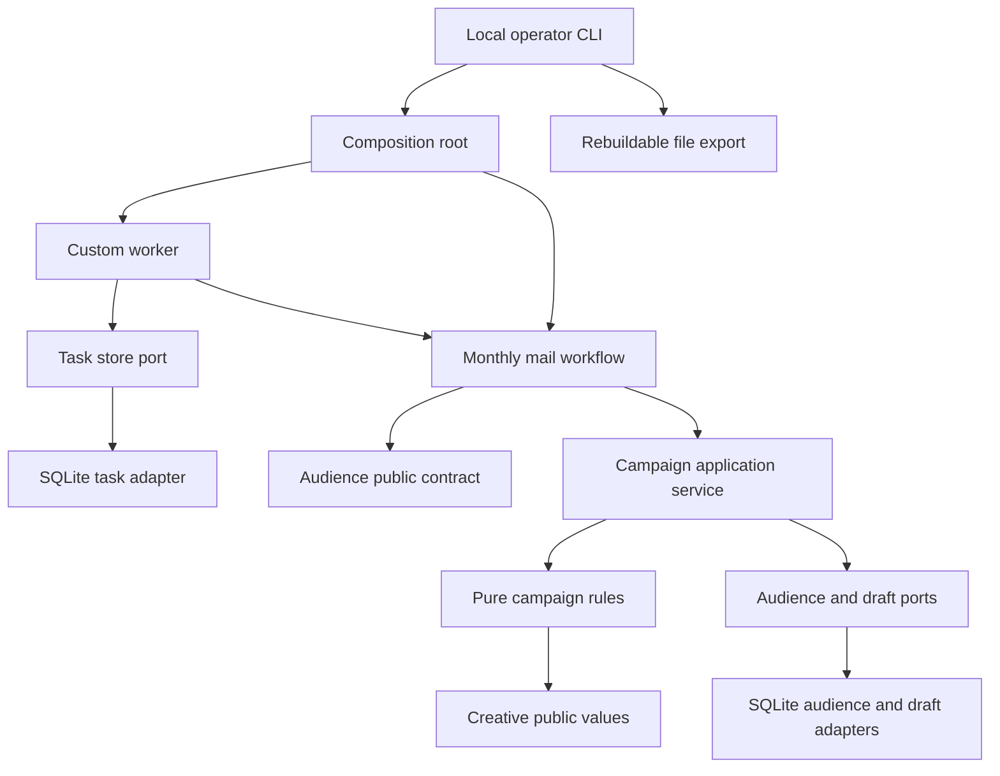

# Modular monolith architecture

Decision accepted for day one, 25 October 2026: **one Python application, organized by business module, with a small set of ports and adapters**. The custom runtime schedules work; it does not own the campaign's business rules. SQLite is the local transactional adapter. The CLI is the first entry point.

This is a focused workflow architecture. The source implements a synthetic local dry run, including day-two OpenRouter tool calls, generated copy and frozen editorial memory. Day three adds local reviewer decisions and simulated acceptance through the reviews module. Persistent experimental outcome learning, hosted identity and external agency delivery remain subsequent work. `AGENTS.md` and the executable import checks preserve the boundaries as those features arrive.

## Why this shape

The workflow needs coordinated state and reliable recovery, while the team and deployment remain small. One deployable process avoids unnecessary network transactions. Modules keep change and test boundaries explicit. Narrow protocols isolate the I/O we actually have; ordinary Python functions remain sufficient for rules and calculations.

We chose this over horizontal global `domain/`, `services/` and `repositories/` folders because each business module should own its vocabulary and public surface. We also deferred microservices, generic repositories, a message bus, event-sourced state reconstruction and a custom workflow language. None is required for the demonstrated outcome.

## Repository structure

```text
src/acquisition/
  runtime/          lifecycle values, task-store port, bounded worker
  audiences/        business records, immutable snapshot contract, storage port
  campaigns/        campaign brief, selection/assignment rules, draft service and port
  creative/         versioned creative values, bounded copy loop and editorial memory port
  reasoning/        provider-independent inference limits, gateway and call journal ports
  learning/         Beta-belief value and counted mathematical update
  reviews/          immutable proposals, review policy, decision and acceptance ports
  workflows/        explicit monthly-mail integration through public module APIs
  adapters/
    sqlite/         task/audience/draft, frozen contexts, creative and inference persistence
    openrouter.py   HTTP adapter; no orchestration or business-rule authority
    review_report.py escaped read-only HTML review projection
    synthetic.py    seeded synthetic source
    files.py        rebuildable CSV, letters and manifest export
  contracts.py      technical JSON/hash helpers and shared errors only
  bootstrap.py      composition root
  __main__.py       CLI entry point
scripts/            architecture verification
tests/              domain, persistence, process and import-boundary tests
research/           standalone mathematical illustration
docs/               decisions, operational guide and future design
```

Inside a module, use `domain.py` for pure values and invariants, `application.py` when a use case needs orchestration, and `ports.py` when I/O is required. A module need not contain all three files. Create new abstractions when a concrete consumer needs them.

Cross-module imports use the provider module's `__init__.py` exports. The campaigns module currently consumes audience and creative contracts. Runtime imports neither campaigns nor learning. Domain code cannot import SQLite, filesystem adapters, workflow wiring or application services. Adapters may implement several ports in one deployable application, but their SQL stays private.

The source of module truth is its public Python contract and tests, not file names alone. `scripts/check_architecture.py` checks declared dependencies, private cross-module imports, domain dependencies and cycles among business modules. It also tests seven deliberate boundary violations. This is static import enforcement; Python reflection and malicious in-process code are outside its protection.

## Purpose through execution



The first scenario is `inspect audience → build draft → wait for review checkpoint`. After an exact checkpoint acknowledgement, it records dry-run completion. Acknowledgement does not create approval or release authority. There is no send/print capability in this implementation.

## Ownership and transaction boundaries

| State or claim | Authoritative owner | Commit/recovery behavior |
| --- | --- | --- |
| Request identity and task lifecycle | Runtime task store | Organization plus request ID binds exact task inputs; changed inputs conflict |
| Current worker ownership | Task lease token and expiry | Checked again inside the transaction that writes a result or failure |
| Run/task result and event history | Same SQLite transaction | A failed event insert rolls back the result and lifecycle changes |
| Audience population | Content-addressed snapshot | Stored bytes, organization and snapshot identity checked on read |
| Selection, exclusions, money, assignments | Campaign domain | Computed over complete supplied input; no LLM decision can bypass a rule |
| Exact draft artifact | Content-addressed manifest and stored CSV bytes | A run's draft operation is unique; retries must produce the same artifact |
| Filesystem export | Derived projection | Rebuilt from verified stored bytes; edits do not change the authoritative artifact |
| Review checkpoint | Runtime waiting reference | Acknowledgement must match that exact reference and the current waiting state |
| Model inference | Reasoning call journal | Reserve before dispatch, check current task lease, replay recorded responses, refuse uncertain automatic retries |
| Editorial context and generated copy | Creative module | Organization-scoped examples, immutable context and content-bound creative identities; all output unreviewed |
| Sourced product wording | Reviewed local fact pack inside frozen creative context | Checked official source, dated review window, exact text/qualifications and fact IDs; revalidated before draft persistence |
| Semantic claim screen | Separate inference request, validated by creative module | Complete A/B verdict bound to exact copy/pack; a pass grants no approval authority |
| Review authority | Reviews module and SQLite review adapter | Exact immutable subject, monotonic evidence/suppression epochs, reviewer generation, expiry and current validation at acceptance |
| Simulated agency acceptance | Same local review transaction | One accepted job per case; acceptance, audit and command receipt commit together; replay observes that historical receipt |
| Bayesian counts and creative support | Future learning application service | Day one supplies mathematical types and assignment evidence, not durable outcome ingestion |

We deliberately avoid a transaction spanning runtime and campaign internals. The campaign commits its deterministic artifact under a stable operation ID; the runtime then commits its task receipt. If the process dies between those commits, recovery retrieves the same artifact. This works because the operation is deterministic and idempotent. It is not an automatic pattern for non-idempotent external effects.

Cancellation fences later task commits. A deterministic draft computation already in flight may still leave an unreferenced artifact; it grants no external authority. Real external effects will require separate authorization, idempotency and reconciliation at their own boundary.

The POC supports one active worker. Transactional claims were also tested under two simultaneous callers to establish that duplicate claims do not create two current owners. That test does not establish multi-node operational readiness. Leases use a clock supplied by the application; production deployment needs an agreed time source and lease/heartbeat policy for longer tasks.

## Audience and experiment semantics

Synthetic data contains stable record/business IDs, a frozen segment, model/version metadata, response propensity, suppression, address usability and contact history. Duplicate business identities are all excluded, rather than arbitrarily picking one record. Exclusions have one primary reason so counts reconcile; overlapping reasons are resolved by documented rule order in the domain function.

The snapshot's completeness flag attests the synthetic generator's supplied batch. This cannot prove completeness of a future warehouse feed; a real source adapter must verify partition inventory, expected counts and freshness independently.

The draft enrolls a bounded high-score cohort first, then deterministically randomizes within each segment into A/B/no-mail. Control and treatment therefore come from the same selected population. Integer pence calculations conservatively reserve enough budget for every enrolled business, including potential holdouts; the draft may leave budget unused. Small segments may not receive a holdout, and the manifest exposes that limitation.

CSV assignments retain segment, business, arm and creative identity for later outcome joins. Creative identity includes its exact content hash. The workflow pins the catalogue hash in its stored inputs so a changed catalogue cannot silently resume old work. Product fact/disclosure validation runs with grounded copy generation; local editorial decisions are separate day-three records.

## Testability of the whole system

Pure tests verify policy with hand-written expected populations and explore seeded budget boundaries. Persistence tests use actual SQLite transactions, concurrent connections, forced storage failure and lease recovery. A CLI test creates, works, inspects, exports, acknowledges and completes a run across separate OS processes. The same composition root is used by the CLI and tests.

These layers are complementary. A module unit test cannot establish restart behavior, and a successful end-to-end run cannot establish every policy boundary. The [day-one validation ledger](day-one-validation.md) records the supported invariants and remaining gaps.

## Evolution without premature extraction

Day two added copy generation and explicit wire validation behind the current capability surface, with a provider-independent reasoning module and an OpenRouter adapter. The workflow order remains explicit in code; the model chooses only context-read and copy-submission actions. See `docs/model-integration.md` for its controls and live evidence. Day four can add cohort/outcome ingestion and a persistent belief store inside learning. Neither addition requires runtime to import those modules.

The current `monthly-mail/v3` extension adds source-bound product rendering and a separate semantic claim screen within creative. The workflow checks the frozen evidence's review date again before creating a campaign draft. See `docs/product-grounding.md` for the evidence/authority boundary, recovery tests and live results. The original v2 capabilities remain available for explicit historical replay.

The claim port accepts a worker-eligibility predicate. The composition root supplies model/configuration compatibility through the workflow; runtime contains no model-specific policy. The SQLite adapter evaluates eligibility before claim or expired-lease recovery. Configuration mistakes therefore leave a run resumable. Schema v3 freezes the exact plans present at migration and the task store checks that certificate before executing retired capabilities. It rejects new retired-capability admission and never refreshes certificates on restart. All durable timestamps and calculated lease/retry times must be finite. This migration is forward-only; older binaries reject newer schemas. Schema v4 adds review tables without refreshing the legacy admission cutoff.

Initialization takes a SQLite write lock before reading `user_version` and keeps that lock through every migration and version change. Migration statements use `execute` inside the transaction; `executescript` is excluded because it can commit a pending transaction. Failure rolls back the complete chain. If the earlier initialization race has left version 2 with a schema-v3 admission table, initialization restores the version marker without expanding the existing admission snapshot.

WAL activation happens after the migration commits because SQLite cannot change journal mode inside that transaction. A busy result during activation is retried on a fresh connection, with a ten-second retry deadline and a short per-attempt busy timeout. The retry does not reapply migrations. Other SQLite errors and exhausted contention are reported rather than hidden.

Use the standard library for day one so the persistence/recovery slice runs without credentials or third-party installation. Python 3.11 or later is declared; the verification host ran Python 3.14.3. Introduce and pin external dependencies when they serve an implemented use case.

Move SQLite behind the existing ports to PostgreSQL when deployment/concurrency requirements justify it, adding real migrations and compatibility tests. Add durable external dispatch through an outbox once the agency integration creates that need. This migration will require engineering and new evidence; the ports do not make it automatic.

The local organization flag is a scope selector, not authentication. A hosted service needs identity, permissions, operational monitoring, retention and secret controls before exposure. Until then the application remains a local synthetic tool.

## Day-three review boundary

The reviews module consumes only public audience, campaign and creative contracts. Its pure domain validates exact candidates and hashes approval subjects. Its service coordinates refresh preparation through a narrow proposal-builder port; workflows implements that builder using existing campaign rules. The SQLite review adapter owns local roles, active evidence, cases, decisions and simulated acceptance. Runtime has no review-specific dependency.

Approval is distinct from checkpoint acknowledgement and semantic screening. The model cannot issue a reviewer decision. Read-only HTML is a derived snapshot; all decisions and simulated acceptance recheck current state transactionally. Local actor registration is trusted administration, not hosted authentication. The active evidence registry requires manual source verification. See the [day-three guide](day-three.md) for the exact invalidation, replay and concurrency rules and their bounded test evidence.
