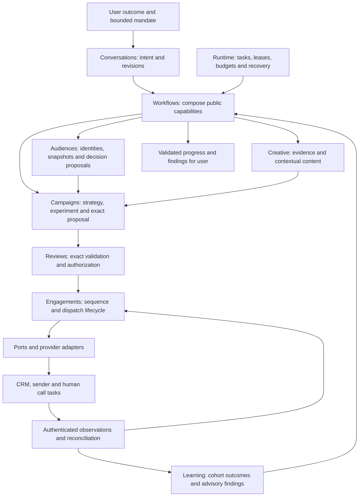

# Agent-led acquisition channel expansion

Date: 13 November 2026

Status: proposed product and architecture direction. This document authorizes no external sending, CRM writes, paid inference or production deployment. It does not describe newly implemented features. The existing postal simulator, legacy contracts and execution restrictions remain in force.

Implementation tracking: [epic #60](https://github.com/DG-creative-lab/direct-acquisition-agent/issues/60) contains 18 native subissues, #61 through #78, with module ownership, acceptance criteria and a dependency map. The first complete simulation milestone is #61 through #68. Existing #23/#26 work remains separately tracked; completed #25/#33 supply baseline contracts.

Implementation notes (14 November 2026): #61 supplies [organization profiles](organization-profiles.md), #62 supplies [scoped contact evidence](contact-evidence.md), and the #63 slice supplies [offline audience strategies](audience-strategies.md). These additive API/CLI foundations preserve the postal workspace and grant no outbound authority. The broader journey and baseline facts below describe the original proposal.

The #64 slice adds [bounded recipient context](recipient-context.md) with reviewed synthetic facts and exact provenance. Personalized email/call copy and the broader orchestration below remain separately tracked work.

## 1. Product decision and scope

Evolve the application into an organization-independent B2B acquisition workspace. A user expresses an outcome; the agent researches permitted sources, proposes an audience and channel strategy, prepares contextual content, validates the result, obtains required approval, executes within that authority and reports verified observations.

Retain the Python modular monolith, pure domain rules, public module APIs, narrow ports, provider adapters and `bootstrap.py` composition root. Introduce a boundary only when an implemented use case needs an owner. Keep runtime business-agnostic and React a presentation client. Do not introduce microservices, a generic CRM object store, service locator, event bus or unrestricted agent executor.

Company independence means replacing business-specific assumptions with reviewed, versioned organization and product profiles. It does not mean every industry, jurisdiction or sending purpose is immediately supported. Enterprise readiness requires separate identity, operational and data-governance evidence.

Initial expansion: email plus human call tasks, retaining postal experiments. Support a complete simulated journey before live effects. Separate permission-based email from unsolicited prospecting, because provider permission and legal eligibility can differ. Keep UK-first policy as an initial explicit profile; broader markets require separately reviewed profiles. Keep GBP as the initial supported currency and make currency explicit in new contracts. Additional currencies need money, budget and reporting work rather than a label change.

Preserve iwoca as a named reference profile and immutable historical example. Demonstrate company independence with a second synthetic B2B company and a different product, audience taxonomy, qualification text and CTA. Changing organizations must not require campaign-service edits.

Defer autonomous voice calls, automatic replies to prospects, social-network automation, an unlimited connector marketplace and continuously adapting live allocation. Human calling requires a sales representative; the agent prepares, schedules and records tasks. Agent-led operation does not imply that software performs every real-world activity.

### Evidence boundary

Repository evidence: [architecture](architecture.md), [product](product.md), [execution ownership](execution-authority-decision.md), [scope](requested-campaign-scope.md), [agent contracts](agent-contracts.md), [campaign validation](campaign-validation.md), [reviews](reviews.md), [learning](learning.md), and current audience/campaign/creative/review ports and domain code.

Current facts: the campaign scope fixes iwoca Flexi-Loan, UK postal mail and response experiments; the audience is synthetic; the contact record has no email or telephone identity; product grounding checks an iwoca-specific official URL; supported segments are hardcoded; acceptance is simulated; learning has a fixed 28-day window and one-cohort-per-business rule. Existing skills describe bounded installed capabilities and grant no authority. Selected execution modes remain intentionally paused.

Public provider documentation and research are cited below. No CRM account, sender account, live model or real recipient was exercised for this plan. Provider account permissions, customer data availability, budgets, operational capacity and commercial results remain unverified.

## 2. Intended experience and success

Example request: "Use our connected CRM to prepare a two-week campaign for suitable UK accounts. Personalize emails using approved business context, arrange calls where appropriate, keep within the budget and bring me the complete proposal for approval."

The agent resolves the organization, product, connections, market, existing preferences and supported capabilities itself. It asks only for a material unresolved choice or authority that cannot be obtained from trusted context. It must not silently invent a spend cap or choose among materially different products.

The user receives one concise review packet: selected population and exclusions, proposed sequence, exact personalized messages, call guidance, source coverage, unresolved limitations, costs, schedule, sender, connections, stop conditions and validation results. Expandable evidence and full exports support detailed review. A sample is useful for inspection but cannot substitute for validation of every intended recipient's payload.

After required approval, the agent continues through the approved sequence without asking the user to navigate configuration forms or authorize each harmless read. Read-only inspection remains available alongside the conversation. Optional controls are alternate access to the same commands, not an obligatory wizard.

| Actor | Desired outcome | Observable success | Failure borne by |
| --- | --- | --- | --- |
| Acquisition operator | A suitable, contextual campaign with little administration | One intent progresses to a complete proposal and authorized execution; routine steps need no intervention | Lost time, wasted spend and bad targeting |
| Reviewer or accountable owner | Understand and control the exact commitment | Approval shows all material effects, limits and exceptions; changes cannot inherit authority | Brand, policy and commercial exposure |
| Sales representative | Relevant calls with useful context | Correct assigned contact, evidence-backed talk track and clear disposition recording | Unusable tasks and wasted calling time |
| Recipient | Relevant contact respecting preferences | Correct identity and facts; objections stop applicable future activity | Unwanted, misleading or excessive contact |
| Organization administrator | Controlled integrations and data use | Scoped access, revocation, retention and attributable effects | Data loss and cross-organization access |

Primary commercial success is an organization-defined, verifiable acquisition outcome and its incremental cost/value. Replies and meetings can be intermediate outcomes. Opens, model scores, generated content volume and tool-call success do not establish acquisition success.

## 3. Whole-system flow and module ownership

The arrows show workflow/data flow, not permission for private or cyclic imports. Bootstrap wires public services and port implementations. Runtime schedules registered host work without importing the business modules. New dependencies need explicit architecture-check declarations and acyclic public domain contracts.

| Owner | Expanded responsibility | Boundary retained |
| --- | --- | --- |
| `conversations` | Resolve requests against installed capabilities; freeze mission, revisions, continuation and generation budget consent | Interpretation is not identity, approval or execution authority |
| `audiences` | Accounts and contacts, provider references, immutable source snapshots, permission observations, feature batches and replaceable categorization/ranking contracts | Scores cannot grant marketing eligibility or invent facts |
| `campaigns` | Objective, reviewed profile references, channel strategy, capacity/cost constraints, experiment assignment and immutable proposal | No provider SDKs or actual dispatch |
| `creative` | Reviewed product/brand evidence, permitted recipient context, email and call-script artifacts, grounded generation and content validation | Screens remain advisory; product and recipient facts retain sources |
| `reasoning` | Existing bounded LLM gateway, model settings, reservations and versioned reasoning assets | Statistical audience inference is not forced through a text-completion interface |
| `reviews` | Exact approval subject, validation composition, expiry, revocation and local suppressions | Existing simulator approval cannot authorize live outbound effects |
| `engagements` (proposed) | Enrollment, ordered channel steps, recipient stops, dispatch intents, external effect identities, observations and reconciliation | Introduce with the first sequence slice; it owns neither product facts nor approval decisions |
| `learning` | Experiment-level outcomes, maturity, completeness, incremental comparisons and advisory recommendations | Transport events and model judgments are not independent conversions |
| `adapters` | CRM reads/writes, email sending/inbound, task systems, model inference and persistence | Translate provider behavior without broadening authority |
| `workflows` / `bootstrap.py` | Compose use cases and wire configured implementations | No duplicated business rules or runtime service discovery |

Keep reviewed product/evidence profiles with their existing creative ownership initially. Avoid a new product-management module until independent lifecycle requirements justify it. Hosted membership and access administration need an explicit ownership decision during the enterprise slice; do not hide them in runtime or the browser.

## 4. Replaceable integrations and decision models

### Port candidates

These are semantic responsibilities, not proposed final Python signatures. Each implemented port must specify organization, connection, native identity, exact inputs, contract version, authorization, bounds and failure semantics.

| Port and owner | Responsibility | Important returned evidence |
| --- | --- | --- |
| Audience source, `audiences` | Read bounded account/contact populations and incremental changes | Source snapshot, complete/partial coverage, cursor, observed time and native references |
| Audience categorizer, `audiences` | Assign supported business categories from a frozen feature batch | Taxonomy version, strategy/version, feature digest, missing inputs, abstentions and category provenance |
| Audience decision strategy, `audiences` | Propose ranks or allocations against a declared objective | Metric semantics, horizon, model version, calibration/evaluation reference, uncertainty and coverage |
| Recipient-context source, `creative` | Retrieve allowlisted facts relevant to the requested communication | Source, ownership, permitted use, timestamp and contradiction/missing flags |
| Existing model gateway, `reasoning` | Bounded drafting, interpretation and screening | Frozen request/settings and inference reservation/receipt |
| Email sender, `engagements` | Submit exact authorized payloads and reconcile results | Provider account/message identity, accepted/rejected/unknown state and deduplication window |
| Inbound/transport source, `engagements` | Verify and normalize replies, objections and delivery events | Signed native event identity, occurrence/receipt times and verified message/contact association |
| CRM activity/task writer, `engagements` | Create approved activities or human call tasks and reconcile writes | Native object ID/version, exact effect digest and partial/unknown outcome |
| Outcome source, `learning` | Join declared commercial outcomes to frozen assignments | Provenance, metric definition, coverage watermark, corrections and missingness |

A CRM can implement multiple ports. Do not require one large `CRMProvider` interface or pretend every CRM supports the same write, lookup or event semantics. Preserve native types, custom field mapping, account identity, API version, association evidence and merge/deletion events. A capability description distinguishes supported, unsupported and temporarily unavailable operations.

Changing between already installed compatible adapters should require validated configuration, field mappings and authorization, without changes to campaign rules. Adding a new provider still requires an adapter and conformance evidence. A provider lacking a required semantic capability must be rejected or offered a concrete alternative for approval; it must not be treated as interchangeable merely because its method names match.

Use explicit bootstrap wiring with a small allowlist of installed implementations. Store connection references and capability/version bindings in the plan; keep credentials in adapters. Do not allow tenant configuration or skills to import arbitrary code. OAuth/account setup can require an administrator's one-time interaction; the agent can diagnose and request that action without making campaign operators complete setup repeatedly.

### Separate eligibility from decision intelligence

The sequence is source verification, hard channel eligibility, strategy proposal, deterministic constraint enforcement and experiment assignment. Recheck eligibility at each external effect. An ML model may prioritize eligible accounts but cannot override objections, unsupported markets, budgets or evidence requirements.

Support rules, externally supplied scores, a classical model and an LLM categorizer through appropriately typed contracts. Do not compare response propensity, fit, expected value and incremental uplift as though they were the same score. Preserve the objective, treatment, horizon, units, training/evaluation provenance, feature availability, calibration and abstentions. An explanation is evidence of model reasoning, not proof that a recipient has a need.

Freeze feature schema, taxonomy, strategy, model/configuration and output for each campaign. A strategy change creates a new proposal. Record deterministic seeds where meaningful; hosted-model replay relies on saved outputs rather than a claim of deterministic inference. Model timeout or missing features cannot silently select another model or invent a complete batch.

## 5. Operational objects and authority

| Object | Identity and relationships | Lifecycle and authority |
| --- | --- | --- |
| Organization/profile binding | Organization + version/hash; product, brand, market, money and evidence references | Reviewed configuration; cannot migrate historical iwoca artifacts by reinterpretation |
| Account/contact reference | Organization + connection/account + native type/ID + mapping version | Identity resolution, merges and deletion preserve provenance; a matching name is insufficient |
| Audience/feature snapshot | Content identity, declared population, coverage and as-of time | Immutable input; partial sources cannot claim complete selection |
| Permission observation | Contact/account, channel, purpose, source, scope and observed/expiry times | Evidence used by current policy; absence is unknown, not consent |
| Context fact | Subject, source/version, exact evidence, permitted use and freshness | Verified source statement, separate from model interpretation |
| Decision proposal | Frozen features, strategy, semantics, objective and outputs | Advisory until campaign constraints and review pass |
| Creative artifact | Exact recipient, channel, subject/body or talk track, facts and renderer hashes | New personalized text means a new identity; unapproved on creation |
| Sequence proposal | Frozen population, all materialized messages, tasks, timing, costs, sender and provider bindings | Immutable review subject; no execution authority by itself |
| Approval/grant | Exact sequence subject, purpose, reviewer generation, limits and expiry | Revocable authorization for declared effects only; revalidated before dispatch |
| Enrollment/step | Campaign assignment, contact/account, step and immutable artifact | Mutable lifecycle with append-only observations; no duplicate active step effect |
| Dispatch intent/receipt | Stable logical effect ID + exact payload hash + provider binding | Prepared, attempted, accepted, rejected or uncertain; remote acceptance is not delivery |
| Observation/outcome | Provider-native event plus exact dispatch/assignment relation | Evidence with occurrence and receipt times; no execution permission |

All durable data, object resolution, inference, connection use and caches remain scoped by organization. New schemas must prevent a provider-native ID reused in another account from resolving to the wrong recipient.

### Who can decide what

| Consequential claim | Proposer | Verifier/owner | Authorization and freshness |
| --- | --- | --- | --- |
| "This is the intended contact" | Agent | Scoped resolver using CRM/source identity and associations | Current connection authorization; ambiguity prompts a bounded clarification |
| "This fact may be used" | Agent selects | Reviewed source policy plus retrieved evidence | Purpose, retention, freshness and organization restrictions apply |
| "This person may receive this email/call" | Agent requests evaluation | Campaign/channel policy using permission observations and current suppressions | Recheck immediately before each effect; model confidence cannot substitute |
| "This strategy is suitable" | Agent/decision model | Deterministic constraints and accountable reviewer | Exact strategy, population, cost and declared limitations |
| "This content is ready for review" | Creative workflow | Structural/source validators plus recorded semantic screening | Exact candidate and current required evidence; no approval implied |
| "This may be sent or created externally" | Agent proposes | Reviews and authoritative effect-admission transaction | Exact live-purpose grant, role, expiry, connection and current stop fences |
| "It was delivered or converted" | Provider/source | Engagement/outcome adapters and verified joins | Native evidence and coverage; acceptance alone does not prove either |
| "This worked better" | Agent explains | Learning's defined analysis over counted outcomes | Maturity, denominators, independence and uncertainty retained |

The initial live pilot requires explicit approval of the complete frozen sequence. One decision can authorize many prevalidated steps within its exact limits. Future standing mandates could allow bounded recurring work, but require their own grant lifecycle, tenant policy and evidence; this plan does not treat a general chat instruction as an unlimited mandate. Consent to an agreed generation budget can cover routine drafting/repair calls within its bounds without repeated permission prompts.

## 6. Personalization, tools and skills

Personalize using relevant, authorized evidence: account activity, contact role, prior interactions, expressed needs and approved business signals. Distinguish observed facts, plausible interpretation and proposed relevance. Do not invent familiarity or infer private financial distress from an industry label. Avoid unnecessary sensitive data in prompts and exports. Conflicting or stale facts trigger retrieval, omission or a clarification rather than stronger wording.

Proposed content workflow:

1. Retrieve bounded context through approved sources and retain fact-level provenance. Treat CRM notes, webpages, email bodies and attachments as untrusted data rather than instructions.
2. Form a recipient-specific relevance hypothesis and choose permitted product facts. Sparse context can yield honest segment-level copy, subject to quality policy, rather than fabricated specificity.
3. Draft channel-native content. Email includes subject, body, sender/reply-to, CTA and required unsubscribe/disclosure material. Call guidance includes identity/introduction, reason for relevance, discovery questions, approved claims, objections, next step and do-not-contact handling.
4. Assemble factual claims, qualifications and official links from the reviewed pack. Extend the existing v3 grounded workflow with an explicit compatible successor; never bypass v3 by selecting legacy input formats.
5. Validate every rendered recipient payload, including inserted names/values and HTML/text output. An independent semantic screen checks support, relevance, tone, misleading implications and data disclosure. Bounded revision cannot silently change the audience, product facts or scope.
6. Freeze all intended outputs before review. Approval binds exact personalized artifacts, or an independently designed and approved constrained rendering contract in a later slice. The first slice does not authorize free-form generation at send time.

Candidate tools: resolve product/profile, inspect connections, retrieve audience/context, propose audience decisions, propose sequence, draft content, validate proposal, request exact approval, execute authorized step, inspect effects and explain outcomes. These names are design candidates; install only the required bounded schemas in the appropriate task. Read, propose and effect capabilities remain distinct. The model has no generic `execute_anything`, raw SQL, arbitrary HTTP or credential-reading tool.

Candidate skills: plan multichannel acquisition; investigate account context; categorize and prioritize audience; write grounded email; prepare human call guidance; assess sequence readiness; interpret replies for triage; explain experiment outcomes. Each declares applicability, required evidence, installed tools, outputs, validation requirements, budgets and stop conditions. Skills are versioned reasoning procedures with no authority; they cannot register tools or implement hidden policy. Extend the current frozen agent-assets mechanism rather than introducing another skill runtime. New user preferences affect future admissions; they do not rewrite saved contexts.

Reply handling initially records and stops or routes work. Any automatic outbound reply is a new external effect and is deferred. Text classification may suggest an objection/disposition, but cannot erase the original response or silently resume outreach.

## 7. Validation before presentation and before effects

Validation is layered. There is no general machine proof that arbitrary marketing prose is true, suitable and commercially effective. Strong structural guarantees, source checks, semantic evaluation and accountable review address different questions.

| Boundary | Required checks | Failure behavior |
| --- | --- | --- |
| Before planning inputs become usable | Organization, identity, source ownership, coverage, freshness, permitted use and schema | Preserve missing/partial/unknown state; retrieve or ask a focused question |
| Before showing substantive output to the operator | Required schemas, exact artifact provenance, arithmetic, evidence-linked claims, secret/PII disclosure rules, truthful status and uncertainty | Return a validated diagnostic; withhold invalid content and ready/complete claims |
| Before asking for campaign approval | Complete intended population and payload coverage, eligible channels/providers, current evidence, budget/capacity, experiment integrity, content checks and explicit limitations | Block readiness; agent repairs within bounds or escalates a material decision |
| Before each outbound effect | Current grant/role, subject and payload integrity, suppression/permission state, stop fences, connection identity, timing, budgets and effect deduplication | Do not dispatch; explain the exact blocking condition |
| Before claiming success | Verified native receipts/events, exact subject/recipient association, partial counts and reconciliation | State accepted, delivered, failed or unknown accurately |
| Before reporting learning | Declared metric, verified population, maturity, explicit missingness and independent outcomes | Report pending/unknown; never infer non-response from an absent event |

Use explicit `passed`, `failed`, `unknown` and `not_evaluated` results with required-check coverage. Unknown required checks block progression. A checker crash must not turn into a pass. Reports are observations, not authorization tokens. Recompute consequential checks at the effect boundary.

Operator-facing summaries should render validated operational facts deterministically and link interpretations to their evidence. Do not make every progress sentence depend on another LLM judge. Screening of subjective meaning is advisory; unsupported claims must be omitted, qualified or sent for appropriate review. Previewed unapproved content is labelled accordingly.

## 8. Sequence lifecycle and reliable external effects

Sequence states: proposed, awaiting review, approved, active, paused, stopped, completed or superseded. Approval expiry and revocation prevent new steps; they do not erase accepted effects. A pause stops pending work, while a stop records the user's requested scope and durable fence. New intent creates a new proposal where material fields change.

Step states: planned, eligible/due, reserved, dispatching, accepted, rejected, uncertain, cancelled or skipped. Delivery and replies are separate observations rather than a misleading universal linear status. Late events cannot revive stopped enrollments. Terminal steps cannot silently create a second logical effect.

Commit exact authorization evidence, dispatch intent, shared contact/cost reservation, command identity and audit together in the authoritative application store. Check lease and stop fences at commit. Perform network requests outside database transactions. The outbox is a concrete delivery journal owned by engagements, not a general event bus. The inbox durably verifies and records provider events before acknowledgement, then processes them idempotently.

Bind the external idempotency key to organization, logical enrollment/step, frozen payload and provider account. Reuse only for the identical request. Recovery reconciles the original intent. It never switches sender or provider to escape an uncertain effect. A provider switch changes the authorization subject and cannot make an old accepted or uncertain step send again.

Provider deduplication has limits. Resend documents a 24-hour key lifetime [R2]. Retain durable application effect identity beyond that window. After uncertain acceptance, retry only where a documented provider guarantee remains valid and current authority still permits it; otherwise reconcile or obtain an explicit operator resolution. Do not claim end-to-end exactly-once delivery.

Authenticate webhook signatures using the raw body [R3], bind the verified connection to the organization server-side, deduplicate native event IDs and preserve occurrence and receipt times. Handle replays, out-of-order events, missing callbacks and account revocation. Reconcile with bounded provider reads where supported [R4]. Do not equate a signed event with correct recipient association or complete coverage.

Replies, objections, complaints, hard bounces, account deletion and conversions apply policy-specific stop scopes. A reply normally pauses future outreach for human triage; explicit objections stop the applicable contact/channel/purpose, and organization policy may widen the stop to an account. A bounce does not automatically authorize a phone call. OOO handling and resumption need explicit policy. CRM sync errors cannot undo a sender effect or suppress a recorded objection.

Immediately before dispatch, recheck known stops, permissions and grant state. A new external objection can arrive after that check or during a network call. Define a dispatch linearization point, minimize queue delay, use provider cancellation where supported and report any in-flight effect accurately. Do not promise instantaneous global cancellation or retractability once a provider accepts a message.

Two campaigns over the same contact/account must share contact-pressure reservations and deduplication scope. Respect salesperson capacity, local time windows, organization budget and model/provider rate limits. A sequence must not monopolize a lock during inference or remote I/O. Unavailable capability or unresolved state produces a recoverable pause, not an endless clarification or retry loop.

## 9. Learning and research opportunities

Keep the current synthetic learning contract unchanged. Add a separately versioned multichannel experiment contract with strategy-level assignment, account/contact clustering rules, declared commercial metric, costs and maturity. Compare eligible controls, email-only and email-plus-call strategies where sample size and contact permissions support the design.

A sequence of three emails and two calls is a treatment history for an assigned unit, not five independent trials. Suppression, non-delivery, missed calls and early stopping remain recorded treatment/compliance facts. Preserve assignment-based analysis; report delivered/contacted views separately rather than dropping failures from the denominator. Cross-channel interference and multiple contacts at one account require an explicit analysis unit. Repeated cohorts need a reviewed statistical successor, not removal of the existing duplicate-business guard.

Real commercial outcomes may be available for controls through CRM or warehouse data. If the source cannot observe control outcomes or attest coverage, do not manufacture a control conversion rate. Version attribution and completeness policy. Missing remains unknown. The appropriate maturity window depends on the objective; the postal demo's 28 days is not a universal email or revenue window. Corrections/retractions require append-only provenance and reproducible derived counts before real-feed adoption.

| Research track | Falsifiable hypothesis | Experiment and adoption gate |
| --- | --- | --- |
| Evidence-backed personalization | Relevant account context improves qualified response enough to justify retrieval and generation cost | Randomize segment-only versus fact-grounded content; measure incremental qualified outcomes, factual errors, objections and total cost |
| Contact versus no contact | Some high-response accounts would convert without outreach | Randomized holdouts; only consider uplift models after valid treatment/outcome data, overlap and causal assumptions are assessed [R7] |
| Channel selection and timing | A combined sequence improves net value for particular eligible segments | Prespecified strategy arms and human-call capacity; evaluate selection effects and interference |
| Audience strategy replacement | A new categorizer/ranker improves useful selection at equal constraints | Shadow evaluation on frozen features; semantic/calibration checks and prospective bounded comparison before promotion |
| Agent autonomy | Better tools/context reduce routine intervention without increasing false readiness or unauthorized effects | Repeated end-to-end conversational evaluations using final state and effects as ground truth, informed by tau-bench [R8] |
| Resistance to untrusted context | External source content cannot change scope, disclose secrets or trigger unauthorized effects | AgentDojo-style adversarial CRM notes, webpages and inbound emails; test legitimate task completion as well as attack failures [R9] |

These are research proposals, not proven product improvements. Defer contextual bandits until randomized baselines, assignment probabilities, delayed-outcome handling, safe exploration limits and off-policy evaluation exist. Never optimize a bandit directly against opens or a model's self-score. No automatic model fine-tuning or cross-organization learning is authorized by this plan.

## 10. Scenario traces and composed-system checks

Each trace retains organization, mission revision, native identities, source/profile versions, exact proposal/grant and effect IDs. The harness owns saved state and budgets, skills guide bounded reasoning, validators preserve invariants, and observations establish what happened.

| Scenario | Agent, context and capability path | Authority, effect and user-visible result | Acceptance signal |
| --- | --- | --- | --- |
| Ordinary success | Resolve current CRM snapshot; select contextual email/call skill; freeze decisions, per-contact content and sequence; validate and request one approval | Admit exact effects, send within limits, create assigned call tasks, record verified observations and explain progress | Exact eligible recipients/payloads; no campaign-form navigation; no extra approval for routine steps |
| Fuzzy but unique identity | User names a saved audience informally; scoped discovery finds one complete authoritative match | Continue with the resolved reference and show it in the proposal | Automatic resolution without a needless ID question |
| Genuine ambiguity | Two products or materially distinct contact matches remain plausible | Ask one concrete choice; bind response to revision and revalidate | No guessed identity or unauthorized effect; successful continuation after reply |
| Cross-organization substitution | Tool arguments or a webhook name another tenant's connection/contact | Server-derived identity checks reject access and preserve sanitized audit | No foreign reads, reservations, outputs or writes |
| Missing or contradictory context | CRM role conflicts with current source, pagination is incomplete or fact expired | Retrieve within bounds; omit unsupported personalization or pause with explicit partial coverage | No invented fact, false complete audience or ready result |
| Unsupported provider purpose | Agent proposes Resend for unsolicited prospecting | Eligibility rejects that route; propose a permission-based scope or a separately permitted provider strategy for review | No cold outreach via Resend and no silent provider fallback |
| Lost send acknowledgement | Provider may accept, then process dies before receipt commit | Keep original uncertain effect; reconcile original native request, never generate a replacement send | One logical intent; truthful unknown/accepted status across restart |
| Reply during queued follow-up | Verified inbound reply records a stop while another worker prepares a due step | Final fence blocks unsent step; any already in-flight request is reconciled explicitly | No send admitted after the durable stop; no claim that prior acceptance was undone |
| Concurrent campaigns | Two valid missions select the same contact and spend capacity | Shared reservation admits only permitted contact pressure/cost | No doubled cap or budget consumption; recoverable reason for deferred work |
| CRM task write uncertain | Task creation times out after possible remote success | Reconcile original task external key/ID or pause; do not blindly create another | No duplicated sales task; sender history remains accurate |
| Provider/model change | Install second compatible adapter or decision strategy; current campaign remains frozen | New proposal uses declared new versions; old approval cannot switch connection or payload | No core rule edit for an installed adapter swap; incompatible semantics rejected |
| Feedback changes next campaign | Verified complete cohort informs a new strategy hypothesis; user also records a style preference | Learning support, preferences and product facts stay separate; new campaign needs its own authorization | No fabricated trial counts or inherited approval; prior history unchanged |

Whole-system risks to probe include a safe but unusable clarification loop, independent guards disagreeing about eligibility, retry multiplication, stale approvals, source summaries becoming facts, provider abstraction hiding limitations and success summaries omitting partial failure. Test successful recovery as well as correct rejection. Every blocked path needs a specific reason and a permitted next step.

## 11. Delivery sequence and acceptance gates

Implement these as dependency-ordered slices. No calendar estimate is asserted before a first integration spike and baseline measurements.

| Slice | Deliverable and owner | Evidence required before progression |
| --- | --- | --- |
| 0. Reconcile baseline | Execution/conversation owners document supported modes, current offline journey and legacy migration/restore constraints | Existing supported journey and recovery stay intact; unresolved baseline failures have explicit ownership; no bypass of paused execution |
| 1. Organization-independent contracts | Audiences/campaigns/creative introduce versioned profile, account/contact, taxonomy, channel and objective values with narrow ports | iwoca and second synthetic profile run through the same core logic; unknown profiles/markets fail explicitly; old artifacts retain exact hashes |
| 2. Agent-led sequence simulation | Conversations/campaigns/creative/reviews plus new engagements prepare and run an exact email/call proposal in simulation | One conversational request reaches a fully validated proposal, one required approval and correct simulated sequence; objections, revisions and reload/restart work |
| 3. Adapter conformance and authorized sandbox reads | Bootstrap/adapters add one selected CRM source and differing synthetic provider; author capability mappings and decision-strategy conformance cases | Scoped sandbox account/contact reads, pagination, identity drift, missing permissions and strategy abstentions; core workflow does not import provider code |
| 4. Pilot access and operations | Hosted-access owner plus operations establish authenticated membership/roles, connection secrets/OAuth, data-use/retention policy, audit access, dedicated transport and restore procedures | Cross-tenant tests, revoked-session/connection behavior, authorized-data scope, incident ownership and a tested recovery procedure before pilot data or recipients |
| 5. Live permitted email and call-task pilot | Engagements/reviews/adapters implement outbox/inbox, sender and CRM task writes on the pilot access boundary | Authorized test recipients, reviewed provider-purpose match, exact payload approval, bounded spend, timeout/restart/revocation tests and verified delivery/task evidence |
| 6. Real outcome contracts | Learning/adapters add commercial metrics, full assignment joins, completeness and corrections | Complete controls where claimed, explicit missingness, deduplication, mature results and reproducible corrections; no unearned causal claim |
| 7. Enterprise hardening and portability | Access/operations owners deepen isolation, retention/deletion, audit, recovery, customer-required SSO/provisioning and measured concurrency | Deletion across derived artifacts, recovery exercises and performance targets; second real CRM/sender or ML strategy proves portability |
| 8. Research promotion | Audiences/creative/learning evaluate approved hypotheses and optionally bounded mandates | Repeated outcome, authority, autonomy, cost and model-quality evaluations; explicit promotion and rollback decisions |

The live pilot depends on slice 4's identity, authorization, secrets and operational controls. Broader enterprise scale follows measured needs. Do not expose the loopback server or remove its single-worker lock to create a pilot. Public webhook ingress needs a dedicated authenticated transport boundary; it cannot bypass or reuse browser identity/token checks as provider authentication.

First complete vertical slice: a synthetic organization-independent audience, rules-based decision strategy, contextual email/call preparation, exact review, simulated dispatch/task effects, a reply that cancels the next step, truthful progress and restart recovery. Include a second company profile to expose hardcoded assumptions immediately. This validates composition before paid services and live recipients.

### Definition of done for each implemented slice

- Every new effect or authority boundary has an observable regression scenario and real SQLite/restart coverage where persistence matters. Extend existing boundary tests when appropriate.
- Run `make test` and `make arch-check`; run `make interface-check` for frontend changes. New module ownership and import edges are declared in the architecture checker before dependent code lands.
- Extend the implemented invariant ledger in `docs/validation.md` only with behavior actually established. Keep planned contracts in this proposal until implemented.
- Evaluate conversational paraphrases, sparse context, ambiguous goals, revisions and interrupted approvals. Deterministic fixture success is not live-model quality evidence.
- Validate all intended outbound payloads, not only examples. Test incorrect factual support, unsafe rendering, hidden instructions, missing mandatory qualifications, stale evidence and recipient substitution.
- Use provider sandboxes or explicitly authorized test recipients for live integration evidence. Record model/provider/version, task, costs, failures and limits; do not label a stubbed test as live.
- Preserve original v1/v2/v3 artifacts, schema cutoffs, receipts and restored-store fences. Roll back by disabling the new capability, without reinterpreting already accepted effects.

## 12. Evaluation, privacy and rollout

Track task completion and time to acceptable proposal; unnecessary questions and interventions; false-ready and false-block rates; factual support and personalization usefulness; exact authorized versus actual effects; duplicate sends/tasks; stop/cancellation latency; uncertain-state recovery; source coverage; model/provider cost; qualified outcomes and incremental net value. Report distributions by provider, model, profile and scenario rather than one overall pass rate.

Require zero observed cross-organization effects, unauthorized sends, substituted payload acceptances and duplicate logical sends/tasks in the release acceptance corpus. These are release criteria for the tested corpus, not proof of zero real-world risk. Set numerical quality, cost, latency and commercial thresholds after measuring baselines; avoid invented precision. A subjective LLM judge cannot be the only acceptance oracle. Preserve human-reviewed datasets and final database/provider state checks.

Tenant memory separates product facts, user preferences, recipient observations, learned statistical support and operational status. Do not share personalized facts or learned memory across organizations by default. Define retention and deletion for raw context, prompts, derived copy, exports, audit and provider-side data. Preserve justified minimal audit evidence while deleting or redacting personal payloads according to reviewed retention policy; immutable identity is not a mandate to retain personal content forever. Select model providers based on permitted data handling as well as quality and price.

Roll out through deterministic simulation, repeated model evaluation, shadow source/decision reads, an authorized small live cohort and measured expansion. A phase can be technically successful while commercially ineffective; report both. A new provider/model/profile is promoted explicitly after conformance and scenario evaluation, with the previous capability available for future work rollback. Never switch an uncertain in-flight effect as part of rollback.

## 13. Open decisions and assumptions

| Decision/assumption | Recommended starting point | Evidence or decision needed |
| --- | --- | --- |
| Initial customer and buying motion | B2B teams with existing first-party context and permission-based contacts | A concrete design partner, real workflow and measurable acquisition outcome |
| First CRM | One provider chosen from the first customer's stack | Account capabilities, object mappings, OAuth scopes, licensing and API constraints; HubSpot/Salesforce are examples, not selected implementations |
| Sender | Resend is a candidate for opted-in campaigns only [R1] | Verified recipient permission, industry/purpose fit and account authorization; cold outreach needs a separately permitted path |
| First calling implementation | Agent-prepared human call tasks | Representative capacity, task system, current calling eligibility and disposition workflow |
| Domain/market independence | Versioned company/product profile; explicit UK-first policy | Second-company fixture; reviewed additional jurisdictions and purposes before enabling them |
| Personalization depth | Minimum relevant permitted context with fact-level references | Context availability, retrieval cost, legal/privacy basis and human quality assessment |
| Approval granularity | Complete materialized sequence with bounded steps | User evidence that one clear approval is usable; later mandates require a separate authority design |
| Audience model | Transparent rules baseline plus typed replaceable strategy | Objective/feature contract and prospective evidence before adding complexity |
| Outcome metric/window | Defined by customer business outcome | Real authoritative feed, control visibility, maturity and completeness watermark |
| Enterprise operations | Minimum controls before real pilot, measured scale afterward | Hosted access owner, isolation tests, operational SLOs, retention and restore exercises |

Failure of the assumptions should narrow or change the scope. In particular, unavailable contact permission, unavailable relevant context or unobservable outcomes cannot be repaired by more persuasive copy or a larger model.

## 14. Research and provider references

Checked 13 November 2026. Provider terms and APIs must be rechecked during implementation and account activation. The implications below are design inferences unless described as provider behavior.

- **R1. [Resend acceptable use](https://resend.com/legal/acceptable-use)**, updated 13 October 2026: prohibits unsolicited/cold outreach and requires opted-in recipients. Implication: the sender adapter needs permitted-purpose eligibility, not only API compatibility. Do not use a different route through the same provider to evade its policy.
- **R2. [Resend idempotency](https://resend.com/docs/dashboard/emails/idempotency-keys)**: documents a 24-hour key lifetime. Implication: durable application effect identity and reconciliation must outlive provider deduplication.
- **R3. [Resend webhook verification](https://resend.com/docs/webhooks/verify-webhooks-requests)**: requires signature verification over the raw request body. Implication: transport authentication and replay/identity handling are separate checks.
- **R4. [Resend retries and replays](https://resend.com/docs/webhooks/retries-and-replays)**: callbacks retry and can be manually replayed, including successful deliveries. Implication: use a durable inbox and deduplicate; recovery must not repeat campaign effects.
- **R5. [Salesforce object metadata](https://developer.salesforce.com/docs/platform/api-rest/guide/resources-sobject-describe.html)**: describes provider object fields and relationships. Implication: adapters need explicit native schema/mapping contracts and drift handling.
- **R6. [HubSpot sequences](https://knowledge.hubspot.com/sequences/create-and-edit-sequences)**: combines email and human tasks with reply/meeting unenrollment. This supplies a workflow comparison, not an assertion that a particular subscription/API exposes every operation needed here.
- **R7. [EconML treatment-effect motivation](https://www.pywhy.org/EconML/spec/motivation.html)**: distinguishes personalized intervention effects from ordinary outcome prediction. Use as a research basis for future uplift evaluation, not as evidence that this platform has causal models or sufficient data.
- **R8. [tau-bench](https://arxiv.org/abs/2406.12045)**, 2024: evaluates interactive tool agents against resulting state and repeated-trial reliability. Borrow the evaluation method; historical benchmark scores do not establish current model performance.
- **R9. [AgentDojo](https://arxiv.org/abs/2406.13352)**, 2024: evaluates tool agents consuming untrusted data under prompt injection. Borrow adversarial scenario design; prompt defenses alone do not grant effect safety.
- **R10. [ICO B2B marketing guidance](https://ico.org.uk/for-organisations/direct-marketing-and-privacy-and-electronic-communications/business-to-business-marketing/)**: distinguishes corporate and individual subscribers and electronic-mail/live-call rules. The page notes ongoing review after legislative changes. Implement reviewed market/channel rules, current objection handling and appropriate data-processing basis; never equate a CRM contact with permission.
- **R11. [Gmail sender guidelines](https://support.google.com/mail/answer/81126?hl=en)**: documents requirements for personal Gmail delivery, including authentication and additional bulk-sender requirements. Sender readiness is an operational capability with provider-specific scope, not a generic promise of inbox placement.

This proposal changes no installed capability, application code, existing approval purpose, model budget or external account.
