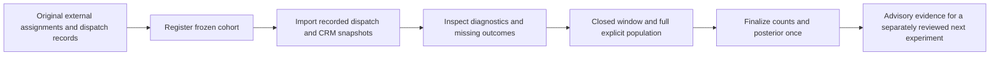

# Registered campaigns and recorded outcome reports

This Python API/CLI slice records externally executed postal or email campaigns,
imports local JSON snapshots and calculates separate, advisory Bayesian results.
It makes no provider calls. It does not send campaigns, authenticate provider
records, add a browser screen or change synthetic learning memory.

An active local operator attests the source records. `confirmed: true` is a
statement by that operator, not independent verification. A claimed digest records the evidence identity stated by the operator;
the referenced bytes are not fetched or independently verified. Future Resend/CRM
connectors need authenticated source/account mapping, trustworthy pagination and
watermarks, correction policy and reconciliation before being treated as verified
feeds. The original synthetic importer remains synthetic-only.

## Workflow and authority



Exporting or approving a platform draft does not prove it was sent. Register the
external dispatch identity, exact content hash and `sent`, `failed` or `not_sent`
status for each assigned treatment. Failed or unsent assignments stay in the
original denominator. Untreated holdouts have no dispatch or creative. This
measures outcomes under the assigned strategy, not responses conditional on
delivery. Delivery, bounce, open, click and raw reply events are diagnostics.
Only explicit CRM `qualified_enquiry`/`no_qualified_enquiry` records contribute to
the registered metric. The operator freezes the qualification rule; automatic
replies, unsubscribes, model judgments and engagement scores are not conversions.

Each organization has its own records, actor roles, native identities and cohort
membership. A business can belong to only one learning cohort in that organization,
across this registry and legacy synthetic learning. Native CRM and dispatch IDs
are also reserved by source system/account, preventing aliases from counting the
same original records in another cohort. Local organization selection is not
hosted authentication. Use a separate organization for fixtures.

## Frozen registration contract

See the complete [recorded fixture](../examples/external-outcomes/registration.json).
The envelope requires exactly these fields:

| Fields | Meaning |
| --- | --- |
| `schema`, `mode` | `external-campaign-registration/v1`, `EXTERNAL_OPERATOR_ATTESTED` |
| `data_class` | `recorded_fixture` or `operator_attested_external`; preserved in reports/results and never pooled |
| `organization`, `campaign_id`, `channel` | Original scope/identity; channel `postal` or `email` |
| `metric`, `qualification_rule` | `qualified_enquiry/v1` and explicit bounded qualification wording |
| `assignment_design` | `observational` or `operator_attested_randomized`; neither independently proves randomization |
| `window_start`, `window_end` | Unix seconds, started window of at most 90 days; fixed at registration |
| `prior` | Explicit positive `alpha`, `beta`, each at most 10,000 |
| `sources` | Exactly one `dispatch` and one `outcomes` source; each has `id`, `role`, `system`, `account_id` |
| `assignments` | Frozen original businesses, segments, A/B/holdout assignments, exact creative hashes, CRM record IDs and dispatch records |
| `attestation` | `confirmed: true`, `note`, `evidence_ref`, `evidence_sha256` for the original source evidence |

Assignments contain `business_id`, `segment`, `arm`, `creative_sha256`,
`outcome_record_id`, `dispatch`. Treatment dispatches contain `id`, `status`, `at`,
`content_sha256` matching the assigned creative hash. Holdout creative/dispatch
are null. Each segment requires A, B and holdout, with one exact creative per
treatment. A changed manifest cannot revise an existing campaign or its denominator.
Retrospective registration is permitted and explicitly attested; it does not
establish prospective experimental design or absence of selection bias.

## Report contract and completeness

The [progress](../examples/external-outcomes/progress.json) and
[final](../examples/external-outcomes/final.json) fixtures show full envelopes:

| Fields | Meaning |
| --- | --- |
| `schema`, `mode` | `external-outcome-report/v1`, `EXTERNAL_OPERATOR_ATTESTED` |
| `organization`, `cohort_id`, `data_class` | Exact frozen registration binding |
| `report_id`, `source_id` | Immutable snapshot ID and one registered source |
| `watermark`, `final` | Explicit complete-through time within elapsed window; only outcome source can attest final at exact window end |
| `page_count`, `pages` | All numbered pages 1 through N, each with `number`, `events` |
| `attestation` | Same four fields as registration, binding the uploaded source evidence |

Every event has `event_id`, `business_id`, `arm`, `creative_sha256`, `record_id`,
`kind`, `occurred_at`, `evidence_ref`. Primary outcomes must name the original CRM
record and outcome source. Diagnostics must name the original recorded sent
dispatch and dispatch source, with `occurred_at` at or after the recorded send.
Postal reports cannot claim email opens. New pre-send diagnostics are rejected.
An integrity-checked historical snapshot retains its original pre-send entries,
but those entries are excluded from current event and business counts. Reads
report `reconciliation.status: needs_reconciliation`, the distinct excluded
count, affected report IDs and at most 100 issue samples. Repeated events across
snapshots count once. `issues_truncated` identifies a capped issue sample.
Valid observations and complete primary outcomes can still be imported and
finalized; the reconciliation note does not invent or remove primary trials.
Event identities are native source-system/account identities, stable across
cumulative reports. Exact duplicates add no new support. Changed event content,
reused report IDs with changed snapshots, changed inputs under a command key,
wrong assignments or contradictory outcomes reject the entire transaction.

Positive events occur within `[window_start, window_end)` and no later than the
watermark. An explicit negative is valid only in a final report at the exact
closed cutoff. Missing rows are always unknown. A paginated snapshot may still
be incomplete: finalization needs one final outcome-source snapshot covering
every original business, including holdouts, and an explicit consistent result
for every member. Separate partial final snapshots cannot manufacture a complete
population. An early positive never updates posterior support.

Bounds are 3 to 1,000 businesses, at most 10 segments, 4 MiB per input, 100 pages
and 10,000 raw events per report, 32 reports, 16 MiB total normalized report
evidence and 20,000 unique events per cohort. JSON objects reject duplicate keys,
nonfinite numbers and unknown contract fields. Identities are bounded plain
strings. Evidence references are stored as data, never fetched. Do not upload
credentials or unnecessary personal data in notes or references.

## Finalization and interpretation

One business contributes one binary trial. For n businesses and s qualified
enquiries, posterior parameters are `alpha + s`, `beta + n - s`. Finalization
stores literal counts, prior/posterior, uncertainty, source digests and advisory
comparisons atomically with its audit and receipt. Engagement event counts do
not increase trials. The declared prior is a modeling assumption, not observations.

Comparisons use 10,000 seeded draws per arm, central 90% intervals and the existing
illustrative support thresholds: 30 per treatment, 10 holdouts, probability at
least 90% of beating the other variant and 95% of beating holdout. Only an
operator-attested randomized design can suggest considering a next experiment.
Observational comparisons remain descriptive. These thresholds and probabilities
are not calibrated causal proof or profit estimates. Selection, contamination,
CRM qualification and late attribution remain external data-quality assumptions.
Sampling is reproducible on the same Python runtime, and its frozen policy is
`external-advisory/v1`. A and B may have identical creative hashes as a record of
assignment groups, but that cannot establish a creative winner. The
`distinct-creatives/v1` eligibility rule returns `no_creative_contrast`, null
candidate/winner probabilities and descriptive group intervals for that case.
It applies to new finalizations and current comparison views of older results.
Historical finalization/command receipts retain their original contents; an old
stored winner is not renewed as a current recommendation. Both original-key and
new-key `outcomes-finalize` replays return
`observation: HISTORICAL_RECEIPT_NO_CURRENT_AUTHORITY`, the unchanged
`original_receipt`, and the current eligibility-filtered `comparisons`. The
`finalization` field in `outcomes-show` uses the same historical observation.
The first successful finalization returns its newly committed receipt. A replay
stores only its command binding, never another finalization effect. Use
`outcomes-receipt` to inspect the original receipt with a historical label.

Finalized records are immutable. Exact old report/command replays return original
receipts without recounting; new late reports or corrections reject. Retractions,
repeated business exposure, cross-cohort pooling, live monitoring and use in model
context require later design. This slice stores no `learning_beliefs` or synthetic
memory and grants no targeting, budget, sending or approval authority.

## Run the recorded fixture

Run from the repository root, with a disposable database and separate fixture
organization. The fixed 25 November 2026 window is already closed. All businesses,
content and outcomes are fictional. No model key is needed.

```sh
export PYTHONPATH=src
python3 -m acquisition --db .local/external-outcomes.sqlite --organization outcomes-fixture review-actor --actor operator --role operator
python3 -m acquisition --db .local/external-outcomes.sqlite --organization outcomes-fixture outcomes-register --actor operator --request-id registration-1 --file examples/external-outcomes/registration.json
```

Copy `cohort_id` from the registration receipt into `COHORT`. The committed reports
already bind that exact deterministic ID. Then run:

```sh
COHORT=external_cohort_FIXTURE_ID_FROM_RECEIPT
python3 -m acquisition --db .local/external-outcomes.sqlite --organization outcomes-fixture outcomes-import --actor operator --request-id progress-1 --cohort "$COHORT" --file examples/external-outcomes/progress.json
python3 -m acquisition --db .local/external-outcomes.sqlite --organization outcomes-fixture outcomes-show --cohort "$COHORT"
python3 -m acquisition --db .local/external-outcomes.sqlite --organization outcomes-fixture outcomes-import --actor operator --request-id final-report-1 --cohort "$COHORT" --file examples/external-outcomes/final.json
python3 -m acquisition --db .local/external-outcomes.sqlite --organization outcomes-fixture outcomes-finalize --actor operator --request-id finalize-1 --cohort "$COHORT"
python3 -m acquisition --db .local/external-outcomes.sqlite --organization outcomes-fixture outcomes-show-report --cohort "$COHORT" --report fixture-final
python3 -m acquisition --db .local/external-outcomes.sqlite --organization outcomes-fixture outcomes-receipt --actor operator --request-id final-report-1 --operation import
```

Progress has one positive, five unknown results and no posterior. A mature cohort
with complete final coverage shows `ready_to_finalize`. Finalization has
two trials per arm: A and holdout each one success, B zero. With the illustrative
Beta(1,19) prior, A/holdout become Beta(2,20), B Beta(1,21). Support is too small
for a preferred next experiment.

## Persistence, recovery and architecture

`build_outcomes` composes a learning application and narrow `ExternalOutcomeStore`
port with native SQLite or the existing bootstrap-selected Turso adapter. CLI
commands use local `--db`; remote consumers use the Python composition API.
`ExternalOutcomeFiles` parses bounded local snapshots. Domain validation and
Bayesian arithmetic stay in `learning`; concrete persistence stays in adapters.
No provider credentials, SDK, new service or model dispatch is introduced.

Versioned external records use reserved `external-*` journal keys in existing
learning commands/events, with distinct schemas/kinds and separate report,
membership and native-identity records. Journal hashes and atomic audit copies
detect inconsistent stored evidence. No schema migration is required; version 27
and historical synthetic formats remain intact. Stop older application writers
before using this registry and run all writers from this build or later. Older
builds do not enforce the new external membership fence; mixed-version writes
and rollback writers after external registration are unsupported. These checks do not defend
against an administrator rewriting the whole database and all evidence.

Registration/report/finalization use one database write transaction with native
reservations, evidence, audit and original receipt. The operator role generation,
write policy and clock are checked again after command persistence, before commit.
Concurrent writers serialize through database transactions, not process locks.
After a lost acknowledgement, inspect `outcomes-receipt` or retry identical inputs
with the original actor/request ID. An uncertain remote commit is reconciled via
the original receipt on a fresh connection. No paid or outbound work can repeat.

`outcomes-show-report` verifies the chosen report's organization, frozen
registration, record hash, atomic audit and native source-event bindings. It does
not require unrelated reports or cohort finalization to be currently usable.
The original `snapshot` and import receipt remain unchanged; the response adds
a historical observation and report-local reconciliation metadata. Missing or
changed selected-report evidence still fails closed. Exact replays of previously
accepted legacy snapshots are labeled historical. A new report ID cannot use
that path to admit another pre-send diagnostic, and an existing native event
cannot be silently corrected. Data repair remains a separate operation.

`outcomes-show`, `outcomes-show-report` and `outcomes-receipt` open read-only;
they preserve historical bytes and grant no current authority. Clock-regressed
history is labeled and excluded from current posterior projections. Checkpoint
restores and verified/paused stores retain inspection but reject mutations.
Managed Turso service behavior and live provider completeness are not established
by the SQLite-backed Hrana conformance tests. See [validation](validation.md).
