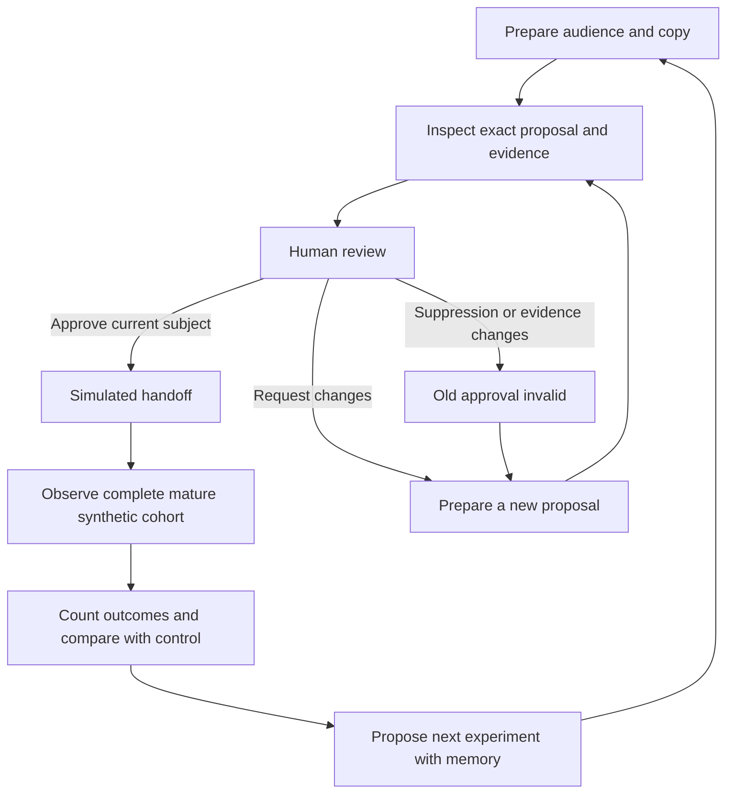

# Campaign user guide

Use this guide with the local React workspace. [Local operations](workspace.md) covers installation and recovery. The workflow below uses offline fixtures and spends no provider credit.

## 1. Prepare a campaign

In a new chat, choose **Try the offline example**. The agent saves the brief, prepares the contractor experiment in the background, and offers **Review campaign**. Progress survives refresh.

For a custom brief, describe the objective, audience and explicit GBP budget. Sending invokes bounded OpenRouter planning. To request generated copy, say so in the message and enable **Allow model copy for this request**. The agent continues through preparation and checks, asking only for missing input or permission. It ends at an unapproved review candidate. A new message stops continuation of the earlier brief.

The manual campaign controls remain available: choose **New campaign**, select **Offline fixtures** and choose **Prepare campaign**. The workspace creates a separate synthetic sandbox with 1,000 business records, two audience segments and four fixture variants. The campaign displays a simulated clock. Independent new campaigns preserve previous campaigns in their own sandboxes.

Model copy is optional. Selecting **Generate with GPT-OSS-120B** explicitly requests provider inference using the server's OpenRouter key and spending controls. Opening or navigating the interface alone makes no inference request. See [grounding](product-grounding.md) before evaluating generated copy.

Choose **Review campaign** in the conversation to inspect and decide on the prepared result without leaving chat. **Open campaign workspace** retains access to the full operational controls.

## 2. Inspect the audience and messages

The **Campaign** view shows source population, mailing recipients, no-mail controls and synthetic cost. The **Audience** tab exposes business assignments, exclusions, suppressions and segment filters. Inspect the counts together; a control is an enrolled business deliberately receiving no mail, whereas an exclusion is outside the experiment.

The **Copy variants** tab shows both treatments for each segment. Expand identity and evidence details to inspect provenance. Historical creative previews preserve their original presentation independently of workspace branding. Download the displayed manifest and assignment files when needed; the server checks the exact displayed subject so a newer revision cannot silently replace its export.

## 3. Review evidence and record a decision

Open **Product evidence** to inspect permitted factual wording, qualifications, source review dates and the active evidence registry. The source pack is manually reviewed; the interface does not monitor the live product page.

Return to **Review & approval**. Read the exact audience, copy and cost, then approve or request changes with a reason. The dialog binds the proposal displayed when it opened. A stale dialog is rejected by the server. Generated copy remains a proposal even if its semantic screen passed.

Approval authorizes only a local simulated handoff. A runtime checkpoint acknowledgement is a different operation and grants no approval authority.

For grounded model copy, **Revise copy** opens feedback tied to the displayed subject and selected variant. Enable generation permission and submit the request. The agent preserves the audience, budget, assignments and product wording, then generates and screens the chosen hook. It records the original subject as needing changes and presents a new unapproved subject. Inspect it before approving. Offline fixture copy cannot use this revision path.

If a revision is **blocked**, inspect its recovery guidance. Restore the server-side key or original model settings to let the same saved request continue. Expired evidence requires reviewed current evidence and a new campaign. Reloading preserves the blocker; submitting duplicate feedback does not repair it. An uncertain outcome retains its separate warning about possible processing and charges.

## 4. Exercise an approval invalidation

Before accepting the job, suppress a selected mailing business and record a reason. The current approval becomes invalid. Choose **Rebuild draft**, inspect the revised audience and cost, then record a fresh decision. Rebuild preserves the copy; replacing copy or expired grounded evidence requires a new generated draft through the review/CLI workflow described in [review reference](reviews.md).

Evidence and policy changes, expiry, reviewer changes, rejection and revocation can also invalidate authority. Refreshing the page or replaying an old command does not restore it. This is the important distinction between a historical decision and current permission to act.

## 5. Simulate handoff

In chat, choose **Simulate agency handoff** after a valid approval, inspect the bound subject and approval in the confirmation, then confirm. The full campaign workspace also retains its handoff control. The backend checks the proposal, evidence, current suppression state and reviewer authority in the acceptance transaction. It records one simulated acceptance with its audit event and receipt.

The chat shows the saved receipt and downloads for the exact accepted campaign. If a response is lost, reload and choose **Check saved handoff** to reuse the original request. A dismissed reminder does not cancel or undo an acceptance.

Nothing is printed or sent. Repeating the command observes its original receipt rather than creating another job. After acceptance, the case is historical and cannot acquire a new proposal or decision. A revocation can record withdrawn authority but cannot retract that accepted simulation.

## 6. Observe and finalize outcomes

In chat after acceptance, open **Synthetic campaign learning**, choose **Open outcome window** and confirm the bound acceptance. The **Learning** workspace retains the same controls. Simulating early responses imports positives but does not update beliefs. Confirming **Close window & learn** in chat closes the simulated 28-day window, imports explicit results for the complete assigned population and requests finalization. Time is advanced inside the sandbox; the demo does not wait 28 real days.

Finalization requires maturity, completeness and valid assignment identities. A missing row is unknown, not an implied non-response. The learning view in chat displays exact counts, posterior estimates and uncertainty for each segment/arm. If a response is lost, reload and choose **Check saved learning request** to reuse the original action and cohort. Results deliberately favor one fixture variant to demonstrate recommendations; they are not customer performance measurements.

## 7. Propose another experiment

In chat, choose **Propose follow-up experiment** after finalization. Inspect the frozen learning, budget, hypothesis and independent population. Choose offline fixtures or explicitly permit bounded model generation. Inspect the resulting new campaign and record a fresh approval. Reload exposes an existing child through **Inspect or resume follow-up**; an uncertain provider result must be investigated before another generation.

The chat demonstration expands to a labeled 2,000-record synthetic inventory while preserving and excluding previously allocated business identities. Exhausted or stale populations block preparation. A later chat edit does not change a saved follow-up proposal; use the displayed source budget when deciding whether to prepare it.

The manual **Prepare a next experiment** control retains scoped mature memory in the same sandbox while creating a separate campaign proposal. Model mode freezes that memory alongside editorial guidance. Approval never transfers. The current repeated-business rule prevents opening a second learning cohort over the same population; this path demonstrates memory reuse rather than a production repeated-exposure experiment.

Inspect **Activity log** for committed events and historical receipts. A read-only export or saved report can become stale and does not authorize an operation.

## When an operation stops

| Situation | Operator response |
| --- | --- |
| Stale subject or invalid approval | Reload current state, inspect the change, rebuild or replace where appropriate and obtain a fresh decision |
| Expired product evidence | Manually verify sources and activate an updated pack; regenerate grounded copy when required |
| Server restarted | Reload to obtain the new local browser token |
| Network interruption or server error after a command | Retry the same action in the same browser session so its pending request identity is retained; inspect the current state and receipt |
| Incomplete model preparation | Resume the saved campaign with the pinned configuration; an uncertain provider call remains fenced and needs investigation |
| Conflicting, incomplete or repeated outcome data | Inspect cohort membership and explicit results; the prototype does not support correcting finalized outcomes or repeated exposures |

Do not bypass a failure by changing a clock, editing the database or treating a previous receipt as current permission. For CLI commands and exact invalidation conditions, use the [review](reviews.md), [learning](learning.md) and [model](model-integration.md) references.
